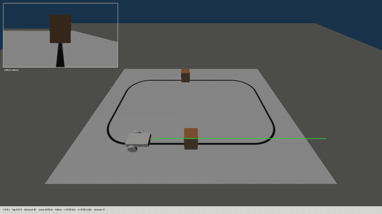
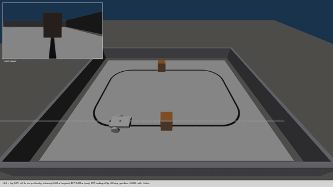
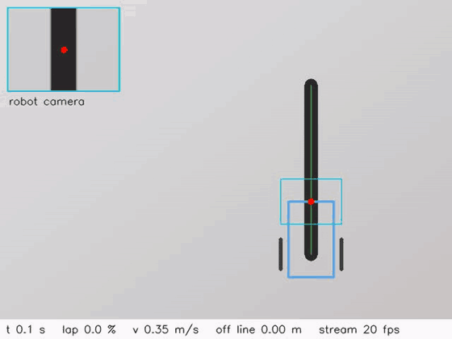
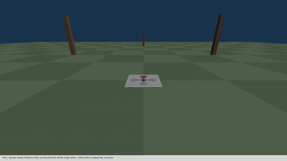
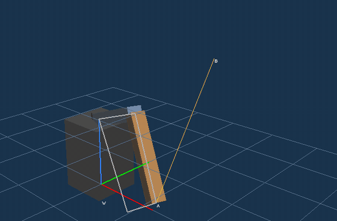
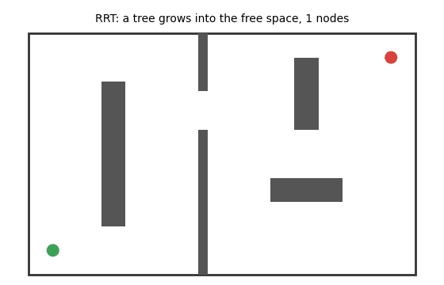
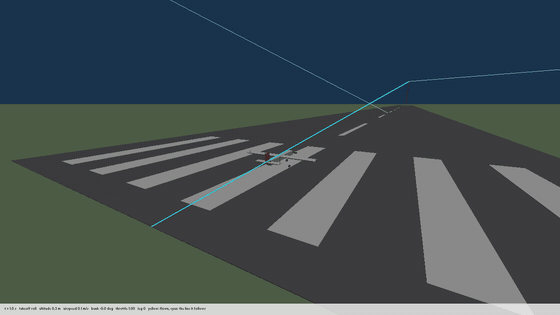

[](https://github.com/pockerman/bitsim/actions/workflows/build.yml)
# bitsim

```bitsim``` is a C++20 library to model, simulate, estimate and control robots, from the maths of
frames and kinematics to a simulated robot that drives with real motors and a real camera. The
documentation is <a href="https://pockerman.github.io/bitrl/index.html">here</a>. Its CMake package and C++
namespace are still called `bitrl`. Reinforcement learning, its environments included, is in
<a href="https://github.com/pockerman/bitrl">bitrl</a>, which builds on bitsim.

<table>
  <tr>
    <td width="50%"></td>
    <td width="50%"></td>
  </tr>
  <tr>
    <td>A differential drive robot in Chrono follows a line with its infrared elements and drives around boxes it hears with its ultrasonic sensor. <a href="examples/07_simulation/line_following_infrared_sonar/line_following_infrared_sonar.md">Example</a></td>
    <td>An extended Kalman filter fuses the encoders, the IMU, the infrared elements, the camera and two sonars: odometry (magenta) drifts, the filter (cyan) stays on the true path (yellow). <a href="examples/08_state_estimation/ekf_sensor_fusion/ekf_sensor_fusion.md">Example</a></td>
  </tr>
  <tr>
    <td></td>
    <td></td>
  </tr>
  <tr>
    <td>Hardware in the loop: the simulated robot follows the line with the frames of a real camera on a Raspberry Pi, streamed over HTTP. <a href="examples/09_hardware_in_the_loop/pi_camera_line_following/pi_camera_line_following.md">Example</a></td>
    <td>A quadrotor flown from the laptop's keyboard with RC stick commands, through an angle mode flight controller. <a href="examples/10_control/quadrotor_rc_simulation/quadrotor_rc_simulation.md">Example</a></td>
  </tr>
  <tr>
    <td></td>
    <td></td>
  </tr>
  <tr>
    <td>A three joint arm in Chrono moves its tip along a straight line, with the joint angles from inverse kinematics at every step; the grey arms are the other solutions for the same point. <a href="examples/03_kinematics/inverse_kinematics/inverse_kinematics.md">Example</a></td>
    <td>A rapidly exploring random tree plans across a warehouse; its path is shortened and compared with A* on an occupancy grid. <a href="examples/05_motion_planning/rrt/rrt.md">Example</a></td>
  </tr>
  <tr>
    <td colspan="2" align="center"></td>
  </tr>
  <tr>
    <td colspan="2">A fixed wing aircraft with a 6-DOF aerodynamic model takes off, flies a circuit of waypoints under an autopilot designed from its linearised dynamics, and lands on the glide slope with a flare and braking; the takeoff and the landing are shown at twice real speed. <a href="examples/10_control/fixed_wing_flight/fixed_wing_flight.md">Example</a></td>
  </tr>
</table>

## What is in it

| Area | What bitrl has |
| ---- | -------------- |
| Frames and kinematics | rotations, frames, Denavit–Hartenberg forward and inverse kinematics of planar and spatial arms, differential drive kinematics |
| Dynamics | differential drive, bicycle and quadrotor models with their Jacobians, a 6-DOF fixed wing aircraft with its landing gear, its trim and its flight modes, a double pendulum |
| Trajectories and planning | time scaling, waypoint trajectories, A* on occupancy grids, RRT |
| Sensors | ultrasonic, infrared reflectance, IMU, a downward camera, MJPEG camera streams and wheel encoders, each simulated or real over MQTT |
| Actuators and boards | DC and BLDC motors, Arduino boards over USB, WiFi and MQTT, RC links |
| Simulation | robots and rigid bodies in <a href="https://projectchrono.org/">Project Chrono</a>, drawn with Irrlicht |
| Estimation | odometry, gyro heading, Kalman and extended Kalman filters, a filter that fuses every sensor of the robot |
| Control | PID and PI controllers, a line follower, a quadrotor flight controller, a fixed wing autopilot that takes off, flies waypoints and lands |

A real sensor or motor and its simulated twin have the same interface, so the code that drives a
simulated robot drives a real one too.

## Examples

The examples go through the library in order, from its basic types to robots on real hardware:
frames and rotations, kinematics, trajectories, motion planning, sensors and actuators,
simulation, state estimation, hardware in the loop and control. They
are listed in [examples/examples.md](examples/examples.md), and each has a page that explains it.

## Build

Ubuntu 24.04 is the reference platform. ``ci/install_deps.sh`` installs the dependencies and
``ci/build_chrono.sh <prefix>`` builds the supported Project Chrono commit.
The full instructions are in [doc/install.md](doc/install.md).

```
cmake -B build -DCMAKE_BUILD_TYPE=Release -DENABLE_TESTS=ON
cmake --build build --parallel
ctest --test-dir build --output-on-failure
```

| Option | Default | Description |
| ------ | ------- | ----------- |
| ``ENABLE_CHRONO`` | ``ON`` | Project Chrono simulation. Add ``-DCMAKE_PREFIX_PATH=<prefix>`` for a non-system install |
| ``ENABLE_MQTT`` | ``ON`` | Paho MQTT support |
| ``ENABLE_OPENCV`` | ``ON`` | OpenCV support |
| ``ENABLE_EXAMPLES`` | ``ON`` | Build the examples |
| ``ENABLE_TESTS`` | ``OFF`` | Build the tests |
| ``BITRL_IRRLICHT`` | ``ON`` | Irrlicht visualization. Requires ``ENABLE_CHRONO`` |
| ``BITRL_LOG`` | ``ON`` | Library logging |
| ``BITRL_WERROR`` | ``OFF`` | Treat warnings as errors in Debug builds |
| ``BITRL_SANITIZE`` | ``OFF`` | Build with AddressSanitizer and UndefinedBehaviorSanitizer |

With ``ENABLE_TESTS=ON``, ``ctest -L examples`` runs every example that needs no hardware, server
or window.

## Contributing

Commits follow [Conventional Commits](https://www.conventionalcommits.org/en/v1.0.0/) and
releases are made from them automatically. See [CONTRIBUTING.md](CONTRIBUTING.md).
