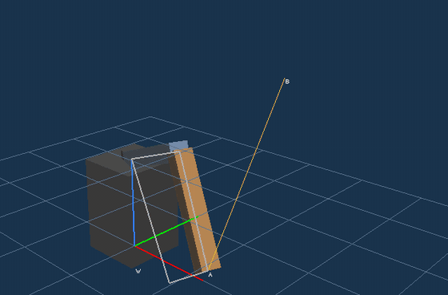

\page bitsim_example_inverse_kinematics Inverse kinematics

This example accompanies the fourth lesson of the robotics course and builds on
\ref bitsim_example_forward_kinematics. We use the same two arms, and ask the opposite question. You need
_bitsim_ configured with Chrono support to run it. The solutions of this example, analytic and numerical,
are in bitsim too: `planar_ik`, `spatial_ik`, `numerical_jacobian` and `numerical_ik` in
\ref bitsim_kinematics.

The arm of section 6 moves its tip along the line from \f$A\f$ to \f$B\f$ and back, with the joint
angles from inverse kinematics at every step. The thin grey arms are the other solutions for the same
point.

## What inverse kinematics is

Forward kinematics gives the end-effector pose from the joint angles, \f$X_{WE} = f(q)\f$. A task, on the
other hand, is usually given in the world: pick up the cup at this point, follow this line. Inverse
kinematics answers the question

> Given where the end-effector should be, what are the joint angles?

that is, it solves \f$f(q) = X_{WE}\f$ for \f$q\f$. In \ref bitsim_example_forward_kinematics we saw that
several configurations can put the tip at the same point, and that some points cannot be reached at all.
So unlike forward kinematics, inverse kinematics can have no solution, one, several or infinitely many.

In this lesson we only ask for the position of the end-effector, not its orientation. Our arms have two
and three joints, which is exactly enough to place a point in the plane and in space.

## Inverse kinematics of the planar arm

For the planar arm the solution can be found with geometry. Shoulder, elbow and tip form a triangle with
sides \f$l_1\f$, \f$l_2\f$ and \f$\sqrt{x^2 + y^2}\f$, and the law of cosines gives the elbow angle:

\f[
\cos q_2 = \frac{x^2 + y^2 - l_1^2 - l_2^2}{2 \, l_1 l_2} \qquad q_2 = \pm \arccos(\cos q_2)
\f]

The two signs are the two elbow positions. The shoulder angle is the direction to the tip, minus the
angle between the upper arm and that direction:

\f[
q_1 = \text{atan2}(y, x) - \text{atan2}(l_2 \sin q_2, \; l_1 + l_2 \cos q_2)
\f]

@code{.cpp}
const real_t c2 = (x * x + y * y - l1 * l1 - l2 * l2) / (2.0 * l1 * l2);
const real_t q2 = sign * std::acos(c2);
const real_t q1 = std::atan2(y, x) - std::atan2(l2 * std::sin(q2), l1 + l2 * std::cos(q2));
@endcode

Always check an inverse kinematics solution with forward kinematics. It is cheap, and it catches most
mistakes in the derivation:

@code
1. Inverse kinematics of the planar arm
  target                     (0.400, 0.300, 0.000)
    q = (0.0, 90.0) gives    (0.400, 0.300, 0.000)
    q = (73.7, -90.0) gives  (0.400, 0.300, 0.000)
  target                     (-0.200, 0.500, 0.000)
    q = (78.5, 80.4) gives   (-0.200, 0.500, 0.000)
    q = (145.1, -80.4) gives (-0.200, 0.500, 0.000)
@endcode

The first target is the point of section 3 in \ref bitsim_example_forward_kinematics, and we get back both
configurations we found there.

## How many solutions

The value of \f$\cos q_2\f$ tells us how many solutions there are:

- \f$|\cos q_2| > 1\f$: the target is outside the workspace ring of the previous lesson, either too far
  or too close. There is no solution, and `std::acos` would return NaN. Real code has to check for this
- \f$|\cos q_2| = 1\f$: the arm is fully stretched or fully folded and the two solutions are the same
- otherwise there are two solutions

@code
2. How many solutions
  target                     distance  solutions
  (0.800, 0.000, 0.000)      0.800     0
  (0.700, 0.000, 0.000)      0.700     1
  (0.500, 0.000, 0.000)      0.500     2
  (0.100, 0.000, 0.000)      0.100     1
  (0.050, 0.000, 0.000)      0.050     0
@endcode

If the two links had the same length, the inner circle would shrink to a point at the shoulder. Every
\f$q_1\f$ would put the tip there: infinitely many solutions.

## Inverse kinematics of the spatial arm

The spatial arm splits into two problems. Joint 1 turns the vertical plane of the arm towards the target,
and in that plane the shoulder and the elbow are the planar arm, with the reach
\f$r = \sqrt{x^2 + y^2}\f$ and the height \f$z - h_0\f$ above the shoulder:

\f[
q_1 = \text{atan2}(y, x) \qquad (q_2, q_3) = \text{planar IK}(r, \; z - h_0)
\f]

The arm can also turn its back to the target, \f$q_1 + 180^\circ\f$, and reach over its head with a
negative reach \f$-r\f$. That gives up to four solutions:

@code{.cpp}
for (const auto &[q1, reach] : {std::pair{facing, r}, std::pair{wrap_angle(facing + PI), -r}})
{
    for (const auto &planar : planar_ik({arm.l1, arm.l2}, reach, z))
    {
        solutions.push_back({q1, planar[0], planar[1]});
    }
}
@endcode

The target is the end-effector position of section 4 in \ref bitsim_example_forward_kinematics, so one of
the solutions is the \f$(90, 30, -60)\f$ we started from there. That is the elbow-up solution facing the
target, which is usually the one we want. The others may be out of the range of the joints, or make the
arm hit the floor or itself. Choosing between solutions is part of the job.

@code
3. Inverse kinematics of the spatial arm
  target                     (0.000, 0.606, 0.350)
    q = (90.0, -20.6, 60.0)    gives (0.000, 0.606, 0.350)
    q = (90.0, 30.0, -60.0)    gives (0.000, 0.606, 0.350)
    q = (-90.0, 150.0, 60.0)   gives (0.000, 0.606, 0.350)
    q = (-90.0, -159.4, -60.0) gives (0.000, 0.606, 0.350)
@endcode

When the target is right above joint 1, \f$x = y = 0\f$, `atan2(y, x)` is not defined. Every \f$q_1\f$
works, and that is another case with infinitely many solutions.

## The Jacobian

Closed-form solutions exist only for arms with a simple structure. For the general case we need the
**Jacobian**, the matrix of the partial derivatives of the forward kinematics. It maps the speed of the
joints to the speed of the end-effector:

\f[
\dot{p} = J(q) \, \dot{q} \qquad J = \frac{\partial f}{\partial q}
\f]

For the planar arm we can differentiate the formula of the previous lesson:

\f[
J = \begin{bmatrix}
-l_1 \sin q_1 - l_2 \sin(q_1 + q_2) & -l_2 \sin(q_1 + q_2) \\
l_1 \cos q_1 + l_2 \cos(q_1 + q_2) & l_2 \cos(q_1 + q_2)
\end{bmatrix}
\f]

Column \f$j\f$ is the velocity of the tip when only joint \f$j\f$ turns, at 1 rad/s. When we do not
have a formula we can still compute the Jacobian numerically, by moving each joint a little and
differencing the forward kinematics. The two agree:

@code
4. The Jacobian
  J at (30, 60)
     -0.500  -0.300
      0.346   0.000
  difference to numerical J  2.8e-11

      q2   det(J)   q1 dot   q2 dot  (rad/s)
    90.0   0.1200     0.15    -0.42
    30.0   0.0600     0.48    -1.13
    10.0   0.0208     1.43    -3.35
     2.0   0.0042     7.16   -16.71
     0.5   0.0010    28.65   -66.85
@endcode

Going the other way, \f$\dot{q} = J^{-1} \dot{p}\f$ gives the joint speeds for a desired tip speed. The
table asks the tip to move away from the shoulder at 0.1 m/s as the arm gets straighter. For this arm
\f$\det J = l_1 l_2 \sin q_2\f$, and as the arm stretches it goes to zero and the joint speeds explode.

A configuration where \f$\det J = 0\f$ is a **singularity**. There the arm cannot move its tip in some
direction at all, here straight away from the shoulder, however fast the joints turn. Singularities are
found at the boundary of the workspace, but also inside it, as for the spatial arm with the tip above
joint 1. Near one, small tip motions need huge joint motions.

## Numerical inverse kinematics

With the Jacobian we can solve inverse kinematics iteratively, for any arm whose forward kinematics we
can evaluate. Starting from a guess \f$q\f$, the error is \f$e = p_{\text{target}} - f(q)\f$ and the
linear approximation \f$f(q + \Delta q) \approx f(q) + J \Delta q\f$ suggests the step

\f[
\Delta q = J^{-1} e
\f]

This is **Newton's method**. Repeat until the error is small. Near a singularity \f$J^{-1}\f$ is huge,
so **damped least squares** adds a damping term \f$\lambda\f$:

\f[
\Delta q = J^T (J J^T + \lambda^2 I)^{-1} e
\f]

For \f$\lambda = 0\f$ this is Newton's step again. With \f$\lambda > 0\f$ the step stays bounded even when
\f$J\f$ is singular. Both versions also limit the size of each step to 0.5 rad, since the linear
approximation is only good close to \f$q\f$.

@code{.cpp}
if (damping == 0.0)
{
    dq = J.fullPivLu().solve(e);
}
else
{
    const RealMat3d A = J * J.transpose() + damping * damping * RealMat3d::Identity();
    dq = J.transpose() * A.ldlt().solve(e);
}
@endcode

Both reach the target of section 3 from the start \f$(0, 45, -45)\f$. Newton's method converges much
faster at the end: the number of correct digits roughly doubles with every iteration. Damping trades that
speed for robustness.

@code
5. Numerical inverse kinematics
  Newton's method
  iteration   q                      error
          0   (0.0, 45.0, -45.0)    8.7e-01
          1   (6.2, 57.4, -73.6)    7.7e-01
          2   (20.8, 68.8, -102.3)  6.2e-01
          3   (49.4, 72.1, -119.9)  4.3e-01
          4   (78.1, 60.4, -113.8)  2.6e-01
          5   (92.0, 40.5, -85.2)   9.1e-02
          6   (89.7, 31.6, -63.2)   1.1e-02
          7   (90.0, 30.0, -60.1)   2.4e-04
          8   (90.0, 30.0, -60.0)   1.5e-07
  reached                    (0.000, 0.606, 0.350)

  Damped least squares
  iteration   q                      error
          0   (0.0, 45.0, -45.0)    8.7e-01
          1   (20.9, 57.3, -73.6)   6.7e-01
          2   (49.6, 63.4, -98.1)   4.2e-01
          3   (78.2, 54.7, -101.3)  2.1e-01
          4   (91.6, 40.0, -84.1)   8.6e-02
          5   (90.0, 35.8, -72.8)   4.2e-02
          6   (90.0, 33.2, -67.3)   2.3e-02
          7   (90.0, 31.9, -64.3)   1.3e-02
         10   (90.0, 30.4, -61.0)   2.9e-03
         15   (90.0, 30.0, -60.1)   2.5e-04
         20   (90.0, 30.0, -60.0)   2.3e-05
         25   (90.0, 30.0, -60.0)   2.0e-06
         27   (90.0, 30.0, -60.0)   7.7e-07
  reached                    (0.000, 0.606, 0.350)

  out of reach target        (0.800, 0.000, 0.900)
  Newton  after 100 iterations q = (0.0, 31.7, 12.3)     error 0.307
  damped  after 13  iterations q = (0.0, 36.9, 0.0)      error 0.300
  closest possible error     0.300
@endcode

The difference shows when the target is out of reach. The best the arm can do is to stretch towards the
target, and that is a singular configuration. Newton's method keeps jumping from one side of it to the
other and never settles. Damped least squares settles in the stretched pose, \f$q_3 = 0\f$, and its
error is the smallest possible. This matters in practice: a target slightly out of reach should not make
the arm shake.

Notice also that the numerical methods find one solution, the one their starting point leads to. Start
from a different guess and you may get another. In a controller the previous joint angles are a good
starting point, and then a single iteration is often enough.

## Following a straight line in simulation

Now we use inverse kinematics to make the Chrono arm of \ref bitsim_example_forward_kinematics draw a
straight line in space. At every step we compute the next point on the line, solve for the elbow-up
joint angles facing it, and give them to the motors through a `ChFunctionSetpoint`:

@code{.cpp}
const ChVector3d target = point_on_line(t_next);
const SpatialJoints q = *spatial_ik_elbow_up(arm, target);
for (int j = 0; j < 3; ++j)
{
    setpoints[j]->SetSetpoint(q[j], t_next);
}
system.DoStepDynamics(step_size);
@endcode

The tip goes from \f$(0.5, -0.2, 0.2)\f$ to \f$(0.2, 0.5, 0.5)\f$ in 2 s, starting and stopping smoothly.
Before the clock starts, the arm is moved to the start of the line and `DoAssembly` puts the bodies
there. We then measure how far the simulated tip is from the line:

@code
6. Following a straight line in simulation
     t   q                      target                   tip in simulation        off the line
  0.40   (-15.8, 29.0, -91.2)   (0.471, -0.133, 0.229)   (0.471, -0.133, 0.229)   1.7e-07
  0.80   (6.0, 44.7, -112.3)    (0.396, 0.042, 0.304)    (0.396, 0.042, 0.304)    4.5e-07
  1.20   (40.4, 57.0, -109.9)   (0.304, 0.258, 0.396)    (0.304, 0.258, 0.396)    3.7e-07
  1.60   (62.2, 54.5, -85.4)    (0.229, 0.433, 0.471)    (0.229, 0.433, 0.471)    1.5e-07
  2.00   (68.2, 49.9, -70.5)    (0.200, 0.500, 0.500)    (0.200, 0.500, 0.500)    3.1e-13
  largest distance off line  4.6e-07
@endcode

The joints move in a complicated way, joint 1 alone turns by 90 degrees, but the tip stays on
the line. Moving each joint smoothly from its start angle to its end angle would also get the tip from
\f$A\f$ to \f$B\f$, but along a curve. To control the path in the world we need inverse kinematics.

The motors here are ideal: they put each joint exactly where we ask, whatever the load. Real motors
need a current to make a torque, and they take time to respond. That is the topic of
\ref bitsim_example_bldc_motor.

## Running the example

@code
./inverse_kinematics
./inverse_kinematics --render
./inverse_kinematics --record DIR
@endcode

With `--render` the arm of section 6 goes from \f$A\f$ to \f$B\f$ along the yellow line, waits, and
comes back, again and again. The orange trail is the path of the simulated tip, and it stays on the line.
`--record DIR` writes the window to `DIR`, ten pictures a second, for one trip there and back, and stops.

The thin grey arms are the other solutions of section 3 for the same target, drawn from shoulder to elbow
to tip. The panel says how many there are. Some of them go through the floor or through the base, which
is why the elbow-up solution facing the target is the one the arm uses.

## Exercises

1. Plot the joint angles of section 6 against time. Which joint moves the most, and when?
2. Make the line of section 6 pass through the point above joint 1, for example from
   \f$(0.3, -0.3, 0.5)\f$ to \f$(-0.3, 0.3, 0.5)\f$. What happens to \f$q_1\f$, and why?
3. Run the numerical method from the starting points \f$(0, 0, 0)\f$, \f$(180, 90, 90)\f$ and
   \f$(-90, 120, 30)\f$. Which solutions of section 3 do you get?
4. Try damping values of 0.01, 0.05 and 0.5 for the out of reach target. What happens to the number of
   iterations, and to the final error?
5. Replace the closed-form solution in section 6 by the numerical one, starting from the joint angles of
   the previous step. How many iterations does it need per step?
