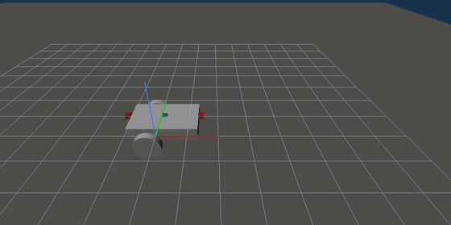

\page bitsim_example_chrono_diff_drive A differential drive robot in Chrono

\ref bitsim_example_diff_drive_kinematics worked out where a differential drive robot goes from its
forward speed and turning rate, with a model of its motion. Here the robot is a simulated body in
Chrono, \ref bitsim::rb::bitsim_chrono::CHRONO_DiffDriveRobot "CHRONO_DiffDriveRobot", the robot that
the later examples drive with their sensors. It drives a short script, and the example compares
where it goes with where the kinematic model says it should.

The robot drives straight, turns on the spot by a quarter of a turn, drives a third of a circle of
radius 1 m and stops. The yellow line is where its axle centre went, the cyan one where the
kinematic model says it should have gone. The squares are 25 cm.

## What you need

bitsim built with Chrono, and with Irrlicht to see the robot; see \ref bitsim_install.

## The robot

The robot comes from its robot file, `robots/bitsim_diff_drive_robot.json`: its chassis, plates and
wheels, two DC gear motors with encoders, and its sensors, which this example does not use. Load it,
place it, and add it to a Chrono system:

@code{.cpp}
CHRONO_DiffDriveRobot robot;
robot.load(bitsim::consts::ROBOTS_DIR + "/bitsim_diff_drive_robot.json");
robot.set_world_pose(0.0, 0.0, 0.0);  // the axle centre at (x, y), facing yaw
robot.add_to_sys(system);
@endcode

The robot needs a floor to drive on: here a fixed box with friction 0.8. Then at every step:

@code{.cpp}
robot.set_velocity(v, omega);  // [m/s] ahead, [rad/s] to the left
robot.update(dt);              // the motors' speed controllers, and their torque on the wheels
system.DoStepDynamics(dt);
@endcode

`set_velocity` turns the command into a speed for each wheel, with wheels of radius \f$r\f$ that are
\f$L\f$ apart:

\f[
\omega_L = \frac{v - \omega L / 2}{r}, \qquad \omega_R = \frac{v + \omega L / 2}{r}
\f]

Each motor's speed controller then sets its voltage to reach that speed. The wheels are driven by
the torque of the motors, and the robot moves because they grip the floor. `axle_center()` and
`heading()` say where it is.

## The kinematic model

\ref bitsim::dynamics::DiffDriveDynamics "DiffDriveDynamics" is the model of
\ref bitsim_example_diff_drive_kinematics. Given the same commands, it says where the robot would be
if its wheels turned at once at the speed they were told and never slipped.

## Running the example

@code{.sh}
./chrono_diff_drive              # headless
./chrono_diff_drive --render     # in a window, in real time
./chrono_diff_drive --record DIR # and write the window to DIR, ten pictures a second
@endcode

It returns 0 if the robot ends within 10 cm of the model.

## Output

@code
Robot: robots/bitsim_diff_drive_robot.json
  wheels of radius 0.100 m, 0.400 m apart

    t [s]  command            v [m/s]  w [rad/s]   x [m]   y [m]  yaw [deg]   model x   model y  model yaw   off [m]
     0.00  straight              0.00      -0.00  -0.000   0.000       -0.0     0.001     0.000        0.0     0.001
     0.50  straight              0.25      -0.00   0.066   0.000       -0.0     0.150     0.000        0.0     0.084
     1.00  straight              0.37      -0.00   0.227  -0.000       -0.0     0.300     0.000        0.0     0.073
     1.50  straight              0.38       0.00   0.418  -0.000       -0.0     0.450     0.000        0.0     0.032
     2.00  straight              0.35      -0.00   0.601  -0.000       -0.0     0.600     0.000        0.0     0.001
    ...
     4.00  straight              0.29       0.00   1.204  -0.000       -0.0     1.200     0.000        0.0     0.004
     4.50  turn on the spot      0.05       0.62   1.286   0.003        9.4     1.200     0.000       22.5     0.086
     5.00  turn on the spot     -0.05       0.98   1.282  -0.001       33.0     1.200     0.000       45.0     0.082
     5.50  turn on the spot     -0.06       1.05   1.262  -0.022       62.7     1.200     0.000       67.5     0.066
     6.00  turn on the spot     -0.03       0.94   1.257  -0.043       91.5     1.200     0.000       90.0     0.072
     6.50  arc                   0.23       0.36   1.243   0.007      109.7     1.189     0.149       98.6     0.152
     7.00  arc                   0.35       0.11   1.183   0.145      115.5     1.155     0.296      107.2     0.153
    ...
    12.50  arc                   0.30       0.30  -0.164   0.909     -161.5    -0.170     0.929     -158.3     0.021
    13.00  stop                  0.29       0.29  -0.302   0.851     -152.9    -0.300     0.866     -150.0     0.015
    13.50  stop                  0.04       0.09  -0.371   0.812     -147.8    -0.300     0.866     -150.0     0.089
    14.00  stop                 -0.07      -0.02  -0.359   0.820     -147.1    -0.300     0.866     -150.0     0.075

At the end the robot is 0.034 m and 1.8 deg off the kinematic model, 0.159 m at most
@endcode

`v` and `w` are how fast the simulated robot moves and turns, not what it was told.

- **The motors take time.** Told 0.3 m/s from standing, the robot is at 0.25 m/s after half a
  second. Their speed controllers then overshoot, to 0.38 m/s, and settle after about 3 s.
- **The robot does not stop at once.** When the turn starts it is still rolling at 0.29 m/s, and
  it rolls on by 8 cm before it turns on the spot. Then it turns slowly at first and too fast
  later, 1.05 rad/s against \f$\pi/4\f$ = 0.79, and ends the quarter turn only 1.5 degrees past it.
- **Errors made early stay.** The heading at the start of the arc is 11 degrees ahead of the
  model's, so the arc starts 15 cm away from the model's. Once the speeds settle, the two arcs come
  together again.

The kinematic model is right about where steady commands take the robot, but not about how it gets
from one command to the next. For that you need the motors; see \ref bitsim_example_bldc_motor and
\ref bitsim_example_real_dc_motors. Then robots measure where they are instead of trusting the
commands: \ref bitsim_example_wheel_odometry.

## Things to try

1. Make `speed_kp` in the robot file twice as big. Does the overshoot grow or shrink?
2. Make the friction of the floor 0.2. Where does the robot slip, and what happens to the error?
3. Add a fifth segment that drives backwards, `{"back", -0.3, 0.0, 2.0}`.
4. Give the kinematic model the speeds the robot really has, from `world.velocity()`, instead of
   the commands. How far apart do they end?

## The code

\include chrono_diff_drive.cpp
