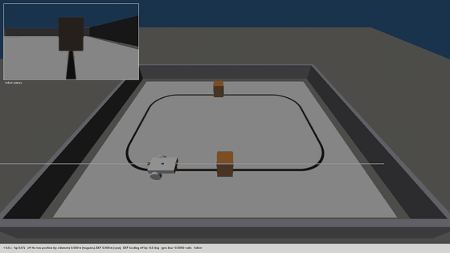

\page bitsim_example_ekf_sensor_fusion Sensor fusion with an extended Kalman filter

\ref bitsim_example_wheel_odometry worked out where the robot is from its encoders and its
gyroscope alone, and showed how that drifts: every error adds up. The robot has more sensors than
those. Its infrared elements and its camera see the line, its ultrasonic sensors hear the walls,
and it knows where the line and the walls are. This example fuses all of them with an extended
Kalman filter, \ref bitsim::estimation::DiffDriveEKF "DiffDriveEKF", while the robot drives its lap
as in \ref bitsim_example_wheel_odometry, now in a room.

One lap with `--radius-error 3`, at twice the speed it ran. The yellow line is the true path of
the axle centre, the magenta one odometry's, which drifts outwards, and the cyan one the filter's,
which stays on the truth. The green lines are the beams of the two ultrasonic sensors.

## What you need

As for \ref bitsim_example_line_following_infrared_sonar, bitsim built with Chrono, Irrlicht and
OpenCV; see \ref bitsim_install.

## The filter

The state is \f$(x, y, \psi, b)\f$: the centre of the axle, the heading, and the bias of the
gyroscope. The filter keeps the state and its covariance \f$P\f$, and does two things:

- it **predicts** with the motion of the robot, at every reading of the IMU, 100 a second;
- it **corrects** with a measurement whenever a sensor has one, each sensor at its own rate.

### Predicting with the encoders and the gyroscope

\ref bitsim::estimation::DiffDriveGyroModel "DiffDriveGyroModel" is the model of the motion. The
encoders say how far the robot drove, \f$d = r(\Delta\theta_L + \Delta\theta_R)/2\f$, and the
gyroscope how fast it turned, less the bias:

\f[
\Delta\psi = (g - b)\,\Delta t, \qquad
x \mathrel{+}= d\cos(\psi + \tfrac{1}{2}\Delta\psi), \qquad
y \mathrel{+}= d\sin(\psi + \tfrac{1}{2}\Delta\psi)
\f]

This is the odometry of \ref bitsim_example_wheel_odometry, with the gyroscope's heading. Its
errors, in the distance, in the gyroscope's reading and a slow wander of the bias, make \f$P\f$
grow at every step, \f$P \leftarrow F P F^T + L Q L^T\f$, where \f$F\f$ and \f$L\f$ are the
Jacobians of the step. The bias is part of the state, so the filter learns it as it goes, instead
of standing still to measure it as \ref bitsim_example_imu_heading did.

### Correcting with the line

A point where the robot sees the line, relative to its axle, is on the track. With the robot at
\f$(x, y, \psi)\f$ that point is at a place of the floor, and its signed distance to the track,
\f$h(x)\f$, should be 0, so 0 is what the filter takes the sensor to measure:

- the **infrared elements** give one point, the mean of the elements that see the line,
  \ref bitsim::sensors::InfraredSensor::line_position "line_position()", 34 cm ahead of the axle;
- the **camera** gives up to four, where the line crosses four bands of its image,
  \ref bitsim::sensors::DownwardCamera::line_points "line_points()", from 20 to 50 cm ahead. Points
  at different distances fix the heading as well as the position.

The line fixes where the robot is *across* it, and says nothing about where it is along it.

### Correcting with the walls

An ultrasonic sensor at a known place on the robot should measure the distance to the nearest wall
or box of the map, \ref bitsim::estimation::DiffDriveMap "DiffDriveMap", along its beam: the
shortest of five rays across the 15 degrees it hears, as the simulated sensor casts them. The
robot has one sensor in front and one behind. Along a straight they fix where it is along the
track, and in a turn they see the side walls.

### The update and the gate

Each correction is an update of
\ref bitsim::estimation::ExtendedKalmanFilter "ExtendedKalmanFilter": with \f$H\f$ the Jacobian of
\f$h\f$ and \f$R\f$ the noise of the sensor,

\f[
S = H P H^T + R, \qquad K = P H^T S^{-1}, \qquad x \leftarrow x + K\,(z - h(x)), \qquad
P \leftarrow (I - K H) P
\f]

A measurement whose innovation is too large for \f$S\f$, \f$\nu^T S^{-1} \nu > 9\f$ per value, is
kept out: a sonar echo off the edge of a box, which the five rays of the model miss, would
otherwise pull the estimate away. The filter works out the Jacobians of the line and of the ranges
by central differences, and those of the motion exactly.

| Sensor | Rate | What the filter takes its error to be |
| ------ | ---- | ------------------------------------- |
| encoders | 100 /s, with the IMU | 1 cm per square root of a metre driven |
| gyroscope | 100 /s | 0.002 rad/s per reading; the bias wanders by 0.0001 rad/s per square root of a second |
| infrared elements | 100 /s | 2 cm |
| camera | 20 /s | 1 cm a point |
| two ultrasonic sensors | 20 /s each | 3 cm |

## Running the example

@code{.sh}
./ekf_sensor_fusion                      # headless, as fast as it can
./ekf_sensor_fusion --render             # in a window, in real time
./ekf_sensor_fusion --radius-error 3     # odometry and the filter take the wheels to be 3 % bigger
./ekf_sensor_fusion --no-calibration     # odometry does not measure the gyro's bias first
./ekf_sensor_fusion --no-sonar           # also --no-ir and --no-camera: leave a sensor out
@endcode

`--record DIR` writes the window to `DIR`, as in \ref bitsim_example_line_following_infrared_sonar.
It returns 0 if the robot went once around the track without touching a box or a wall.

## Output

@code
Track 4.40 x 2.80 m, 2 boxes on it, in a room of 6.00 x 5.00 m
Encoders: 0.10 m wheels; odometry and the filter take them to be 0.1000 m
IMU: 100.00 readings/s, odometry measures the gyro's bias first; the filter learns the bias
Into the filter: infrared yes, camera yes, sonars, ahead at 0.37 m and behind at -0.17 m, yes

    t [s]   x [m]   y [m]  ekf x [m]  ekf y [m]  ekf off [m]  odo off [m]  ekf head off [deg]  bias [rad/s]  state
     0.01  -1.300  -1.400     -1.300     -1.400        0.000        0.000               -0.00       -0.0000  calibrate
     1.00  -1.300  -1.400     -1.300     -1.400        0.000        0.000                0.10        0.0007  follow
    10.00   0.420  -2.005      0.419     -2.030        0.026        0.004               -0.17        0.0029  detour
    20.00   2.030  -1.033      2.035     -1.027        0.008        0.003                0.50        0.0020  follow
    30.00   1.530   1.343      1.536      1.342        0.005        0.014               -0.33        0.0036  follow
    40.00  -0.488   2.012     -0.487      2.037        0.025        0.022               -0.16        0.0029  detour
    50.00  -2.087   0.918     -2.090      0.915        0.004        0.029                0.06        0.0027  follow
    60.00  -1.476  -1.351     -1.481     -1.351        0.005        0.031               -0.27        0.0032  follow

The robot went once around the track in 60.72 s of simulation, 38.73 s of wall time
Detours around boxes: 2 of 2, times it touched a box or a wall: 0
Gyro bias about z: 0.0030 rad/s; odometry measured 0.0033, the filter 0.0032 rad/s
Off the true position, at the end / at most / on average:
  odometry:   0.030 / 0.035 / 0.015 m
  the filter: 0.005 / 0.026 / 0.010 m, heading at most 0.92 deg off
Readings into the filter (used / rejected by the gate): infrared 3591 / 0, camera 849 / 6, sonars 2392 / 32
@endcode

In this simulation odometry is good to start with: the wheels hardly slip and their size is known
exactly. The filter still ends five times closer to the truth, and it learns the gyroscope's bias,
0.0032 rad/s against the true 0.0030. Its largest errors, 2 to 3 cm, are in the detours, where the
robot is off the line and only the sonars correct it. The gate kept 32 sonar readings and 6 camera
readings out.

The filter earns its keep when odometry is worse. Off the true position, at the end and at most:

| Run | Odometry | The filter |
| --- | -------- | ---------- |
| as it is | 0.030, 0.035 m | 0.005, 0.026 m |
| `--radius-error 3` | 0.031, 0.133 m | 0.001, 0.031 m |
| `--radius-error 3 --no-sonar` | 0.031, 0.133 m | 0.010, 0.100 m |
| `--radius-error 3 --no-ir --no-camera` | 0.031, 0.133 m | 0.024, 0.028 m |
| `--no-calibration` | 0.321, 0.397 m | 0.005, 0.027 m |
| `--no-calibration --no-ir --no-camera` | 0.321, 0.397 m | 0.021, 0.028 m |
| no correction at all | 0.327, 0.384 m | the same as odometry |

- A wheel radius 3 % too big makes every distance 3 % too long: odometry is 13 cm off at worst,
  and back near the truth at the end only because the errors of a closed lap cancel. The filter
  stays within 3 cm.
- Without the sonars the filter does little better than odometry: the line fixes the position
  across the track, not along it, and that is where the radius error goes.
- Without the line the sonars alone hold it within 3 cm: in this room they always hear a wall.
- Without calibration odometry's heading drifts by the bias, 10 degrees over the lap, and its
  position by 40 cm. The filter learns the bias, from the line or from the walls alone.
- With every correction off the filter is odometry: it predicts the same way.

## The library

| Class | What it does |
| ----- | ------------ |
| \ref bitsim::estimation::ExtendedKalmanFilter "ExtendedKalmanFilter" | predicts with a motion model, and updates with any number of observation models, each with its own noise and gate |
| \ref bitsim::estimation::DiffDriveEKF "DiffDriveEKF" | the filter of this example: the motion model, the line and the range models, and the map |
| \ref bitsim::estimation::DiffDriveMap "DiffDriveMap" | the track and the walls and boxes, and rays cast through them |
| \ref bitsim::sensors::DownwardCamera::line_points "DownwardCamera::line_points" | where the line crosses the camera's image |
| \ref bitsim::sensors::InfraredSensor::line_position "InfraredSensor::line_position" | where the line is under the infrared elements |

The robot file has a `rear-sonar` now, like the front one but on the back of the chassis and
pointing behind, `"yaw": 180`.

## Things to try

1. Make the sonars' noise in the filter 30 cm instead of 3. What happens to the errors with
   `--radius-error 3`, and why?
2. Move a box 20 cm on the floor but not on the map, in `OBSTACLES` and `make_map()`. How often
   does the gate keep the sonar out, and how far off does the filter go?
3. Start the filter 30 cm from where the robot is. How long does it take to find it?
4. Let the robot drive by the filter's pose instead of the infrared elements: follow the track
   with pure pursuit, as \ref bitsim_example_pi_camera_line_following does with the camera.
5. Add the accelerometer: when the robot stands still it measures the tilt of the floor, and when
   it turns it measures \f$v\omega\f$ sideways.

## The code

\include ekf_sensor_fusion.cpp
