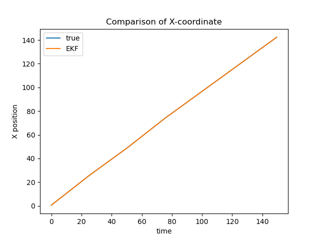
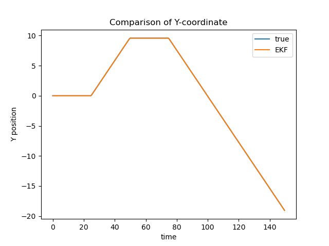
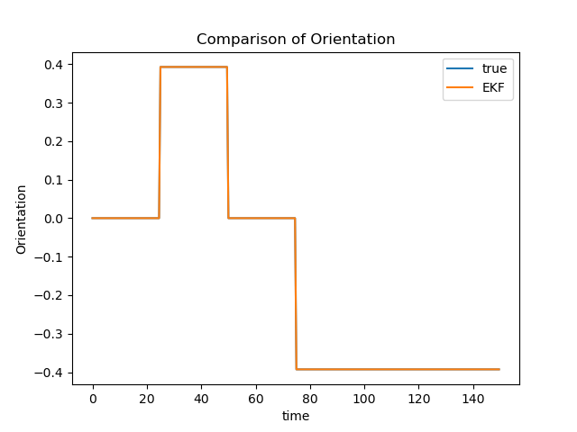

\page bitsim_example_extended_kalman_filter Extended Kalman filtering

The Kalman filter of \ref bitsim_example_kalman_filter needs a linear model. A robot that turns is
not linear: where it goes depends on the sine and cosine of its heading. The extended Kalman filter
(EKF) linearises the model about the current estimate at every step, with its Jacobians, and
otherwise works as the Kalman filter does: it predicts with the motion model and corrects with a
measurement. See <a href="https://en.wikipedia.org/wiki/Extended_Kalman_filter">Wikipedia</a> for
the algorithm. This example estimates the pose of a differential drive robot with
\ref bitsim::estimation::ExtendedKalmanFilter "ExtendedKalmanFilter".

## What you need

Nothing beyond bitsim itself; Python with `matplotlib` for the plots. See \ref bitsim_install.

## The motion model

\ref bitsim::dynamics::DiffDriveDynamics "DiffDriveDynamics" is the model of the robot, see
\ref bitsim_example_diff_drive_kinematics. Its state is \f$(x, y, \theta)\f$ and its input the speed
\f$v\f$ and the rate of turn \f$\omega\f$. Over a step of \f$\Delta t\f$ it drives an arc of length
\f$d = v\Delta t + e_0\f$ and turns by \f$\phi = \omega\Delta t + e_1\f$, where \f$e_0\f$ and
\f$e_1\f$ are errors in the distance and the turn. `update_matrices` works out the two Jacobians
the EKF needs: \f$F\f$, of the new state with respect to the state, and \f$L\f$, with respect to the
errors. The filter predicts the covariance with them,

\f[
P^- = F P F^T + L Q L^T
\f]

where \f$Q\f$ is the covariance of the errors.

## The observation model

`ObservationModel` in the code measures the position: \f$z = (x, y)\f$, so its Jacobian
\f$H\f$ picks the first two components of the state, and \f$M\f$, with respect to the measurement
noise, is the identity. \f$R\f$ is the covariance of the measurement.

## The run

The robot drives at 1 m/s for 150 s, in steps of 0.5 s. At 25 s it turns left by 22.5 degrees, a
rate of 45 deg/s for one step, and at 50 s and at 75 s right by the same. The example runs the
model twice: once on its own, the truth, and once inside the filter, and writes both to
`state.csv`. The measurement here is the filter's own predicted position, with no noise, so the
filter follows the truth exactly; add noise to `get_measurement` to see it filter.

## Running the example

@code{.sh}
./extended_kalman_filter
python plot.py state.csv     # writes x_coordinate.png, y_coordinate.png and orientation.png
@endcode

## Output

@code
Simulation time: 0
Position: 0.5, 0
Orientation: (degrees)0
V: 1, W: 0
...
Simulation time: 25
Position: 25.4872, 0.0969196
Orientation: (degrees)22.5
V: 1, W: 0.785398
Simulation time: 25.5
Position: 25.9492, 0.288261
Orientation: (degrees)22.5
V: 1, W: 0
...
Simulation time: 149.5
Position: 142.426, -19.0373
Orientation: (degrees)-22.5
V: 1, W: 0
@endcode

At 25 s the robot drives the 0.5 m of that step along an arc that turns it by 22.5 degrees, and
then on along its new heading. The plots compare the truth with the estimate, which lie on top of
each other:

## Things to try

1. Add Gaussian noise of 0.5 m to the measurement in `get_measurement`, and compare the estimate
   with the truth and with the noisy measurements.
2. Make the motion errors in `motion_control_error` non-zero for the filter's model only. How large
   does \f$Q\f$ have to be for the filter to follow the truth?
3. \ref bitsim_example_ekf_sensor_fusion_mqtt runs an EKF on data that comes over MQTT.

## The code

\include extended_kalman_filter.cpp
