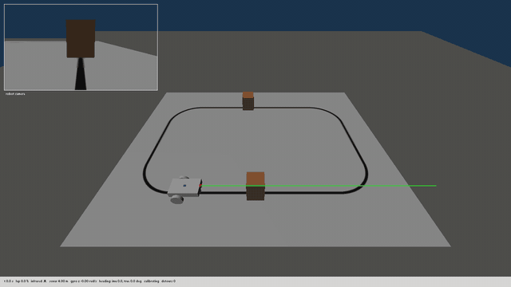

\page bitsim_example_imu_heading Turning by the gyroscope of an IMU

This is \ref bitsim_example_line_following_infrared_sonar with one change. There the robot followed a line with three
infrared elements and drove around boxes that its ultrasonic sensor found, and to turn away from a
box and back onto the line it used the heading that the simulator knows. A real robot does not
know that. Here the robot gets an IMU, an accelerometer and a gyroscope on top of its chassis, and
it turns by the heading it works out from the gyroscope.

One lap, at twice the speed it ran. The blue box on the chassis is the IMU. The bar at the bottom
shows the gyroscope's rate and both headings: the one the robot works out, and the true one.

## What you need

As for \ref bitsim_example_line_following_infrared_sonar, bitsim built with Chrono, Irrlicht and OpenCV, see
\ref bitsim_install.

## The IMU

An IMU such as an MPU-6050 has two sensors with three axes each, along the axes of its board:

- an **accelerometer**, which measures the *specific force*: the acceleration minus gravity. An
  IMU at rest reads 9.81 m/s² upwards, and one in free fall reads nothing;
- a **gyroscope**, which measures the angular velocity [rad/s].

An \ref bitsim::sensors::IMUSensor "IMUSensor" reads six values, the specific force and then the
angular velocity; \ref bitsim::sensors::IMUSensor::acceleration "acceleration" and
\ref bitsim::sensors::IMUSensor::angular_velocity "angular_velocity" pick them out. The robot file
gives it as the `imu`:

| Setting | Value | Meaning |
| ------- | ----- | ------- |
| `type` | `imu` | |
| `backend` | `SIMULATION` | or `MQTT` for a real IMU, see \ref bitsim_example_imu_heading_mqtt |
| `frame_pos` | (0, 0, 0.055) | where it is, from the centre of the chassis [m]. Its axes are the chassis' |
| `update_rate` | 100 /s | readings per second |
| `gyro_bias` | (0.001, -0.002, 0.003) | what the gyroscope reads when still [rad/s] |
| `gyro_noise` | 0.002 | the standard deviation of the gyroscope's noise [rad/s] |
| `accel_noise` | 0.04 | the standard deviation of the accelerometer's noise [m/s²] |

The simulated IMU, \ref bitsim::sensors::backends::CHRONO_IMUBackend "CHRONO_IMUBackend", takes
the motion of the chassis from Chrono. The point \f$P\f$ where the IMU sits, \f$r\f$ from the
centre of the chassis, accelerates by

\f[
a_P = a + \alpha \times r + \omega \times (\omega \times r)
\f]

where \f$a\f$ is the acceleration of the centre and \f$\omega\f$ and \f$\alpha\f$ the angular
velocity and acceleration of the chassis. The accelerometer reads \f$a_P - g\f$ and the gyroscope
\f$\omega\f$, both turned into the axes of the chassis, plus the bias and the noise. The noise comes
from a generator with a fixed `seed`, so every run is the same.

The bias and noise are those of an MPU-6050 after the usual factory calibration: a few mrad/s of
bias, which is a fraction of a degree a second, and a few mrad/s of noise at 100 readings a second.

## The heading from the gyroscope

Turning about the vertical, the z axis of the chassis, the robot's heading changes at the rate the
gyroscope's z axis reads. Adding up rate × time from a known start gives the heading:

\f[
\psi_{k+1} = \psi_k + (\omega_{z,k} - b)\,\Delta t
\f]

with \f$\Delta t\f$ = 10 ms, a reading of the IMU. This is dead reckoning, and any error in the
rate never goes away: it adds up. A bias \f$b\f$ that the robot does not take off makes the heading
drift by \f$b\,t\f$, here 0.003 rad/s, or 10 degrees a minute. The noise adds a random walk, whose
standard deviation grows only with \f$\sqrt{t}\f$: \f$0.002\sqrt{0.01\,t}\f$ rad, about 0.9 degrees
after a minute.

So before it drives, the robot stands still for a second. It is not turning, so the mean of what
the gyroscope reads is its bias, and the robot takes it off every reading from then on. One second
is 100 readings, which measure the bias to about \f$0.002/\sqrt{100}\f$ = 0.0002 rad/s.

\ref bitsim::estimation::GyroHeading "GyroHeading" does both. The robot starts with the heading it is placed at,
0, as a real robot would be placed on its start line.

## What changes in the driving

The rules are those of \ref bitsim_example_line_following_infrared_sonar. The robot follows the line with its infrared
elements, and when the sonar measures less than 0.5 m it turns right by 60 degrees, drives an arc
around the box, crosses the line and turns back onto it. But the 60 degrees are now measured by the
gyroscope: the robot notes its heading from the IMU when it sees the box, and turns until that
heading has changed by 60 degrees.

A turn only needs the heading to be right *relative to where the turn started*, over the few
seconds it takes. That is why integrating a gyroscope works for it even though the heading drifts:
over 2 s the drift is a few hundredths of a degree. The robot still knows how far it has driven
from the simulation, for the 0.34 m it drives on after crossing the line; see the things to try.

## Running the example

@code{.sh}
./imu_heading                    # headless, as fast as it can
./imu_heading --render           # in a window, in real time
./imu_heading --no-calibration   # do not measure the gyroscope's bias first
@endcode

`--record DIR` writes the window to `DIR`, as in \ref bitsim_example_line_following_infrared_sonar. It returns 0 if the robot
went once around the track without touching a box.

## Output

@code
Track 4.40 x 2.80 m, line 0.05 m wide, 2 boxes on it
Infrared: 3 elements, 0.34 m ahead of the axle, 100.00 readings/s
Sonar: 0.02 to 4.00 m, 20.00 readings/s
IMU: 100.00 readings/s, measures the gyro's bias first

    t [s]   x [m]   y [m]  head [deg]  imu [deg]  infrared  sonar [m]  state        v [m/s]  w [rad/s]
     0.01  -1.300  -1.400         0.0        0.0       .#.       4.00  calibrate       0.00       0.00
     1.00  -1.300  -1.400        -0.0        0.0       .#.       0.78  follow          0.30       0.00
     2.00  -1.065  -1.400        -0.0       -0.0       .#.       0.56  follow          0.30       0.00
     3.00  -0.865  -1.414       -31.5      -30.8       ...       4.00  turn away       0.00      -1.00
     4.00  -0.860  -1.440       -72.2      -72.2       ...       4.00  detour          0.25       0.21
...
    60.00  -1.476  -1.351       -10.1      -11.0       .#.       0.98  follow          0.30       0.00

The robot went once around the track in 60.72 s of simulation, 42.20 s of wall time
Detours around boxes: 2 of 2, times it touched a box: 0
While following the line, the elements saw it 100.00 % of the time; the longest time without it was 0.00 s
Gyro bias about z: 0.0030 rad/s, measured 0.0033 rad/s
Heading from the gyro: off by -0.77 deg at the end, at most 1.07 deg
@endcode

For the first second the robot stands still and measures the bias: 0.0033 rad/s, 0.0003 off the
true 0.003, as the noise allows. Over the lap the heading from the gyroscope stayed within about a
degree of the true one. With `--no-calibration`:

@code
Gyro bias about z: 0.0030 rad/s, measured 0.0000 rad/s
Heading from the gyro: off by 10.27 deg at the end, at most 10.31 deg
@endcode

The heading drifted by 0.003 rad/s × 59 s = 10 degrees, as the bias says. The robot still went
around: each turn took a few seconds, over which the drift is small.

\anchor bitsim_example_imu_heading_mqtt
## A real IMU over MQTT

Like the other sensors, the IMU has an MQTT backend,
\ref bitsim::sensors::backends::MQTT_IMUBackend "MQTT_IMUBackend", for a real IMU on a board that
publishes each reading as

@code
{"accel": [0.12, -0.03, 9.79], "gyro": [0.001, -0.002, 0.35]}
@endcode

in m/s² and rad/s, along the axes of the IMU, with an optional `timestamp`. Set `"backend": "MQTT"`,
`broker` and `topic` in the `imu` section of the robot file, and connect the backend as for the
sensors of \ref bitsim_example_line_following_infrared_sonar_mqtt.

## Things to try

1. Set `gyro_bias` to 0.05 rad/s about z, a gyroscope that was never calibrated, and run with
   `--no-calibration`. How far off is the heading after the first detour, and does the robot still
   find the line?
2. Make `CALIBRATION_TIME` 0.1 s and 5 s. How well is the bias measured, and how much does it
   matter here?
3. Raise `gyro_noise` to 0.02 rad/s. The drift is now a random walk; run it with different `seed`s.
4. The robot still measures the 0.34 m after crossing the line with the simulator's position. Use
   the wheel encoders instead: the distance is the wheel radius times the mean of the angles the two
   motors turned by.
5. The accelerometer is read but not used. When the robot is still, its readings give the tilt of
   the chassis; when it turns at \f$\omega\f$ with speed \f$v\f$, the y axis reads about
   \f$v\,\omega\f$. Check both.

## The code

\include imu_heading.cpp
