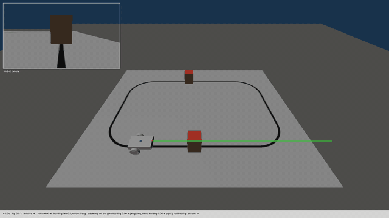

\page bitsim_example_wheel_odometry Odometry from the wheel encoders

In \ref bitsim_example_imu_heading the robot turned by the heading its gyroscope gave, but one thing it still
took from the simulator: how far it drove after crossing the line on its way back to it. Here it
works that out from the encoders on its wheels, so the robot drives only by its own sensors.

The encoders also give *odometry*: where the robot is, from how far each wheel has turned. The robot
keeps two estimates of its pose from them. One takes its heading from the wheels as well, the other
from the gyroscope, and at the end the example says how far each drifted from the true pose.

One lap with `--axle-error 2`, at twice the speed it ran. The yellow line is the true path of the
axle centre, the magenta one the odometry with the gyroscope's heading, and the cyan one the
odometry with the wheels' heading, which drifts outwards.

## What you need

As for \ref bitsim_example_line_following_infrared_sonar, bitsim built with Chrono, Irrlicht and OpenCV, see \ref bitsim_install.

## The encoders

Each wheel's motor is a DC gear motor with an encoder on its output shaft, like the motors of
\ref bitsim_example_real_dc_motors. The encoder has 660 counts a turn, so it measures the wheel's angle in steps
of \f$2\pi/660\f$, about half a degree.
\ref bitsim::actuators::DCMotor::encoder_angle "DCMotor::encoder_angle" gives that angle, in whole
counts, as a board would know it:

| Motor backend | `encoder_angle()` |
| ------------- | ----------------- |
| \ref bitsim::actuators::backends::SIM_DCMotorBackend "SIM_DCMotorBackend" | the angle of the simulated wheel, rounded down to whole counts |
| \ref bitsim::actuators::backends::MQTT_DCMotorBackend "MQTT_DCMotorBackend" | what the board's encoder last reported, as in \ref bitsim_example_real_dc_motors |

The encoder is on the motor, as it is on a real robot, so there is no separate sensor for it: the
robot reads `robot.get_motor(m)->encoder_angle()` for each wheel, at the same rate as its IMU.

## Odometry

\ref bitsim::estimation::DiffDriveOdometry "DiffDriveOdometry" does dead reckoning for a
differential drive. Between two readings the left and right wheels turn by
\f$\Delta\theta_L\f$ and \f$\Delta\theta_R\f$. With wheel radius \f$r\f$ and the wheels \f$L\f$
apart, the robot drives and turns by

\f[
\Delta s = \frac{r\,(\Delta\theta_L + \Delta\theta_R)}{2}, \qquad
\Delta\psi = \frac{r\,(\Delta\theta_R - \Delta\theta_L)}{L}
\f]

and its pose moves along the heading halfway through the step:

\f[
x \mathrel{+}= \Delta s \cos\bar\psi, \qquad y \mathrel{+}= \Delta s \sin\bar\psi, \qquad
\bar\psi = \psi + \tfrac{1}{2}\Delta\psi
\f]

The heading can come from the wheels, \f$\psi \mathrel{+}= \Delta\psi\f$, or from another sensor.
The robot runs both:

- **heading from the gyroscope**: `update(left, right, heading)`, with the heading of
  \ref bitsim_example_imu_heading, and \f$\bar\psi\f$ the mean of the last two headings;
- **heading from the wheels**: `update(left, right)`.

Both start from where the robot is placed, as a real robot is placed on its start line.

## What the robot uses it for

After the detour the robot crosses the line and drives on by 0.34 m, the distance from its
infrared elements to its axle, until the wheels are over the line; then it turns onto it. That
distance now comes from the encoders: the `Driver` notes
\ref bitsim::estimation::DiffDriveOdometry::distance "distance()" when the middle element finds the
line and drives on until it has grown by 0.34 m. Everything else is as in \ref bitsim_example_imu_heading.

## Why odometry drifts

Odometry adds up small steps, and errors in them never go away:

- **counting**: an encoder measures whole counts, so each reading is up to half a degree short.
  That error does not add up, as the next reading counts from the true angle again.
- **slip**: a wheel that slips turns without moving the robot as far. Here the wheels hardly slip,
  as the robot drives slowly on a floor with friction 0.8; a real robot on a smooth floor slips more.
- **geometry**: the odometry needs \f$r\f$ and \f$L\f$. A radius that is off by a percent makes
  every distance off by a percent. An axle length that is off by a percent makes every turn off by a
  percent, and the heading error adds up: after a lap, a full turn, it is \f$2\pi\f$ times that.
  On a real robot \f$L\f$ is hard to know better than to a percent or two, because a tyre touches the
  floor over its width, not at a point.

A heading error is the worst of them, because every step after it goes in a slightly wrong
direction and the position error grows with the distance driven. The gyroscope does not care about
the wheels, so its heading has none of those errors; it has its own, the bias, which
\ref bitsim_example_imu_heading takes off.

## Running the example

@code{.sh}
./wheel_odometry                     # headless, as fast as it can
./wheel_odometry --render            # in a window, in real time
./wheel_odometry --axle-error 2      # odometry takes the wheels to be 2 % further apart
./wheel_odometry --no-calibration    # do not measure the gyroscope's bias first
@endcode

`--record DIR` writes the window to `DIR`, as in \ref bitsim_example_line_following_infrared_sonar. The movie above was made with
`--record frames --axle-error 2`. It returns 0 if the robot went once around the track without
touching a box.

## Output

@code
Track 4.40 x 2.80 m, line 0.05 m wide, 2 boxes on it
Infrared: 3 elements, 0.34 m ahead of the axle, 100.00 readings/s
Sonar: 0.02 to 4.00 m, 20.00 readings/s
IMU: 100.00 readings/s, measures the gyro's bias first
Encoders: 0.10 m wheels, 0.40 m apart; odometry takes them to be 0.400 m apart

    t [s]   x [m]   y [m]  head [deg]  imu [deg]  odo x [m]  odo y [m]  infrared  sonar [m]  state
     0.01  -1.300  -1.400         0.0        0.0     -1.300     -1.400       .#.       4.00  calibrate
     1.00  -1.300  -1.400        -0.0        0.0     -1.300     -1.400       .#.       0.78  follow
     2.00  -1.065  -1.400        -0.0       -0.0     -1.072     -1.400       .#.       0.56  follow
     3.00  -0.865  -1.414       -31.5      -30.8     -0.866     -1.415       ...       4.00  turn away
...
    13.00   1.042  -1.608        49.3       49.1      1.040     -1.610       ..#       4.00  cross
    14.00   1.202  -1.417        49.8       49.6      1.200     -1.420       ...       4.00  cross
    15.00   1.249  -1.362        28.3       28.5      1.252     -1.360       ...       4.00  align
...
The robot went once around the track in 60.72 s of simulation, 38.44 s of wall time
Detours around boxes: 2 of 2, times it touched a box: 0
While following the line, the elements saw it 100.00 % of the time; the longest time without it was 0.00 s
Gyro bias about z: 0.0030 rad/s, measured 0.0033 rad/s
Heading from the gyro: off by -0.77 deg at the end, at most 1.07 deg
Odometry, 14.183 m driven by the encoders:
  heading from the gyro:   off by 0.030 m at the end, at most 0.035 m
  heading from the wheels: off by 0.007 m at the end, at most 0.008 m, heading off by -0.08 deg
@endcode

The odometry columns follow the true pose to a few millimetres, and the robot drove the lap
exactly as in \ref bitsim_example_imu_heading. Here the wheels' heading did *better* than the gyroscope's:
0.08 degrees off after 14 m, against the gyroscope's 0.8. That is the simulation being kind: its
wheels hardly slip, and the odometry knows their radius and axle length exactly. With an axle
length that is 2 % off, `--axle-error 2`:

@code
Encoders: 0.10 m wheels, 0.40 m apart; odometry takes them to be 0.408 m apart
  heading from the gyro:   off by 0.030 m at the end, at most 0.035 m
  heading from the wheels: off by 0.242 m at the end, at most 0.292 m, heading off by -7.07 deg
@endcode

The wheels' heading is off by \f$2\pi \cdot 0.02 / 1.02\f$ = 7.1 degrees after the lap, and the
position by 24 cm; the odometry with the gyroscope's heading does not change. That is why robots
take their heading from a gyroscope and their distance from their wheels.

## Things to try

1. Run with `--axle-error -2` and `--axle-error 5`. Which way does the cyan path drift, and how does
   the heading error compare with \f$2\pi\f$ times the error?
2. Make the odometry's wheel radius 2 % too big. Which odometry suffers now, and why does it hurt
   both?
3. Lower the friction of the floor in `World` to 0.2 and raise `CRUISE_SPEED`. Do the wheels slip,
   and what does that do to the two odometries?
4. Use the wheels' heading for the detour's turns instead of the gyroscope's, with and without
   `--axle-error`. Does the robot still find the line behind the boxes?
5. Combine the two headings: a complementary filter that trusts the gyroscope over seconds and the
   wheels over minutes, \f$\psi = \alpha(\psi + \omega_z \Delta t) + (1 - \alpha)\psi_{wheels}\f$.
   With `--axle-error 2` and `--no-calibration`, which \f$\alpha\f$ does best?

## The code

\include wheel_odometry.cpp
