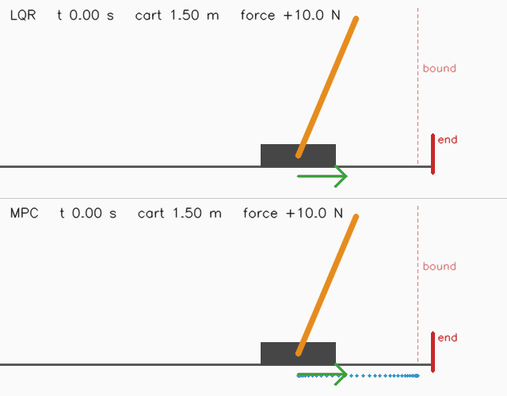

\page bitsim_example_cart_pole_lqr_mpc Balancing a cart-pole with LQR and MPC

A pole hinged on a cart falls over unless the cart moves under it. Balancing it is the classic test of a
controller: the system is unstable, it has one input for two things to control, the pole and the cart,
and the cart has a track that ends. This example balances
\ref bitsim::dynamics::CartPoleDynamics "CartPoleDynamics" with two controllers designed from the same
linear model and the same weights: a linear quadratic regulator (LQR), and model predictive control
(MPC). They start near the end of the track, with the pole leaning towards it, and only MPC knows where
the track ends.

## What you need

Nothing beyond bitsim itself. To make the pictures of the GIF, bitsim built with OpenCV. See
\ref bitsim_install.

## The cart-pole

The state is the position of the cart \f$x\f$, its velocity, the angle of the pole from upright
\f$\theta\f$, positive when it leans towards \f$+x\f$, and its rate. The input is a horizontal force on
the cart, at most 10 N either way. The cart weighs 1 kg, the pole 0.1 kg, and the centre of the pole is
0.5 m from the pivot, as in the cart-pole of Barto, Sutton and Anderson that Gymnasium's CartPole also
uses. The track runs from -2.4 m to 2.4 m.

Upright is an equilibrium, and \ref bitsim::dynamics::CartPoleDynamics::linearise "linearise()" gives the
model about it, \f$\dot x = A x + B F\f$, by central differences.
\ref bitsim::control::discretise "discretise()" turns it into the model of a controller that acts every
0.02 s, with the force held between, \f$x_{k+1} = A_d x_k + B_d F_k\f$:

@code{.cpp}
const CartPoleDynamics model;
const auto linear = model.linearise();
const auto discrete = bitsim::control::discretise(linear.A, linear.B, DT);
@endcode

## LQR

An LQR finds the state feedback \f$F = -K x\f$ that minimises
\f[
J = \sum_{k=0}^{\infty} x_k^T Q x_k + F_k^T R F_k ,
\f]
a sum of how far the state is from upright at the centre, and of how hard it pushes. Q weighs the angle
of the pole most, 10, the position 1 and the two rates 0.1; R weighs the force 0.1. The gain comes from
the discrete algebraic Riccati equation, which
\ref bitsim::control::dlqr "dlqr()" solves:

@code{.cpp}
const auto lqr = bitsim::control::dlqr(discrete.A, discrete.B, Q, R);
bitsim::control::LQRController controller(lqr.K);
controller.set_input_bounds(Vector::Constant(1, -10.0), Vector::Constant(1, 10.0));
@endcode

\f$K = [-2.83, -4.18, -39.57, -9.90]\f$: a pole leaning right, \f$\theta > 0\f$, makes it push the cart
right, under the pole, and the cart away from the centre makes it push it back. The LQR is optimal for
the linear model, but it knows nothing about limits. Its force is clipped to 10 N, which it was not
designed for, and the end of the track is not in its cost at all.

## MPC

MPC plans instead. At every step it finds the forces \f$F_0, \dots, F_{N-1}\f$ over the next
\f$N = 40\f$ steps, 0.8 s, that minimise the same cost, subject to the model and to the limits:
\f$|F_k| \le 10\f$ N, and the cart within \f$\pm 2.3\f$ m, 0.1 m short of the ends. It uses the first
force, and plans again at the next step from the state then.
\ref bitsim::control::LinearMPC "LinearMPC" does it:

@code{.cpp}
bitsim::control::LinearMPC mpc(4, 1, HORIZON);
mpc.set_model(discrete.A, discrete.B);
mpc.set_weights(Q, R);
mpc.set_input_bounds(Vector::Constant(1, -10.0), Vector::Constant(1, 10.0));
mpc.set_state_bounds(x_min, x_max, PENALTY);
const real_t force = mpc.solve(x)[0];
@endcode

- The cost beyond the horizon is that of the LQR: the terminal weight is the solution P of the Riccati
  equation, so with no limit active, MPC gives the LQR's force.
- The bound on the cart is **soft**: the plan may exceed it, at a cost of 1000 per metre and per step,
  plus a quadratic term. A hard bound can be impossible to keep after a large disturbance, and the
  planning problem would then have no solution at all. With the soft bound, MPC keeps to it whenever it
  can.
- Every step solves a quadratic program,
  \ref bitsim::maths::optimization::QPSolver "QPSolver", starting from the plan of the step before.

## Running the example

@code{.sh}
./cart_pole_lqr_mpc                 # print both runs
./cart_pole_lqr_mpc --record frames # and write a picture every 0.04 s to frames/
@endcode

The GIF above is made from the pictures with

@code{.sh}
ffmpeg -framerate 25 -i frames/frame_%04d.png \
       -vf "split[a][b];[a]palettegen=max_colors=64[p];[b][p]paletteuse" cart_pole_lqr_mpc.gif
@endcode

The example exits with an error if MPC lets the cart off the track or does not balance the pole, so it
runs as a test too.

## Output

Both start at 1.5 m, with the pole leaning 0.4 rad towards the end at 2.4 m:

@code
LQR
  time [s]   cart [m]   pole [rad]   force [N]
      0.00      1.500        0.400       10.00
      0.50      2.267       -0.220       -6.00
      1.00      2.283       -0.247       -3.11
      1.50      1.543       -0.017        0.29
      ...
      6.00     -0.006       -0.002       -0.02
  furthest the cart went: 2.436 m, off the end of the track

MPC
  time [s]   cart [m]   pole [rad]   force [N]
      0.00      1.500        0.400       10.00
      0.50      2.269       -0.244      -10.00
      1.00      2.284       -0.182       -2.72
      1.50      1.853       -0.100       -1.08
      ...
      6.00     -0.011       -0.002       -0.02
  furthest the cart went: 2.301 m, on the track

MPC solved 301 QPs, 0 of them not to the tolerance, with 168 iterations on average
@endcode

Both push right as hard as they can at first, to get the cart under the falling pole. The LQR keeps
pushing until the pole is caught, and only then brakes: by then the cart is past the end of the track,
at 2.436 m. MPC sees, 0.8 s ahead, that the cart would cross its bound, and brakes earlier and at full
force, -10 N at 0.5 s where the LQR uses -6 N, tilting the pole back with less travel: the cart stops at
2.301 m. Both then bring the cart back to the centre, the LQR slightly faster, since it did not have to
give anything up to keep to the track. The blue dots under MPC's cart in the GIF are its plan: where it
expects the cart to be over the next 0.8 s.

One MPC step, a QP with 240 variables, the 160 planned states, 40 forces and 40 slacks of the soft
bound, takes about 1 ms here, 170 iterations of the solver on average.

## Things to try

- Start at 1.8 m, or with the pole at 0.5 rad. MPC can no longer keep the cart within 2.3 m: it goes
  past its bound, to 2.66 m from 1.8 m, and still balances the pole. Then make the bound hard, with a
  penalty of 0. From 1.8 m the planning problem has no solution any more, the solver stops at its limit
  of iterations at almost every step, and MPC loses the pole.
- Shorten the horizon. With 20 steps, 0.4 s, MPC still stops the cart at its bound, with half the work
  per step. With 10 steps, 0.2 s, it sees the end of the track too late, gives up the pole and the cart
  drives away: a short horizon with a constraint that becomes active is no longer stable, even with the
  LQR's cost at its end.
## The code

\include cart_pole_lqr_mpc.cpp
