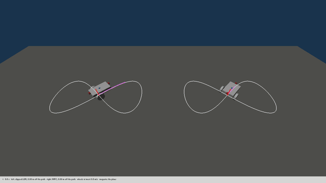

\page bitsim_example_diff_drive_mpc Following a path with model predictive control

The differential drive robot of \ref bitsim_example_chrono_diff_drive follows a figure of eight that is, in
places, faster than its wheels can go: the outer wheel would have to roll at 0.98 m/s, and it can do 0.8 m/s.
Something has to give. This example drives two robots along the same figure, side by side in one Chrono
world. One plans with model predictive control (MPC), which knows the limit; the other runs the same
controller without the limit, and its wheels are clipped to it when they are told more than they can do.

## What you need

bitsim built with Chrono; to see it, or to make the pictures of the GIF, with Irrlicht too. See
\ref bitsim_install.

## The path

The figure of eight is \f$x = 1.2 \sin\varphi\f$, \f$y = 0.6 \sin 2\varphi\f$, once round in 11 s. Its
velocity gives the heading and the speed along it, and its curvature the turning rate; with the axle of
0.4 m, the speeds of the two wheels that drive along it follow. Both robots start on the path and drive two
laps.

## The model

Both controllers plan with the same model of the robot, over one control period of 0.05 s. Its state is the
pose, \f$x, y, \theta\f$, and the speeds the two wheels roll at; its inputs are the speeds the motors are
told. The motors reach a new speed with a lag, and the model has it as a time constant \f$\tau = 0.4\f$ s:
\f[
w_{k+1} = w_k + \frac{\Delta t}{\tau} (c_k - w_k) ,
\f]
with \f$c\f$ the command and \f$w\f$ the speed of a wheel, and the robot drives with what its wheels do,
\f$v = (w_l + w_r) / 2\f$ and \f$\omega = (w_r - w_l) / L\f$.

The model is not linear: the robot moves along \f$\cos\theta\f$ and \f$\sin\theta\f$. At every step the
example linearises it along where the robot is expected to go, the model run from the pose now with the
inputs the last plan had for the coming steps, and gives
\ref bitsim::control::LinearMPC "LinearMPC" one linear model per step of the horizon, with its affine
term. That is *successive linearisation*.

## The controllers

Both plan the next 20 steps, 1 s, and minimise how far the robot is from the path and how much the commands
differ from those of the path, with the same weights. MPC also has the bound \f$|c| \le 0.8\f$ m/s on each
command:

@code{.cpp}
mpc_.set_model(As, Bs, cs);                   // one linear model per step of the horizon
mpc_.set_reference(x_ref, u_ref);             // the path's poses and wheel speeds
mpc_.set_input_bounds(Vector::Constant(2, -0.8), Vector::Constant(2, 0.8)); // MPC only
const Vector commands = mpc_.solve(state);
@endcode

Without the bound, MPC is a linear quadratic regulator along the path, over a finite horizon. Its commands
can be more than 0.8 m/s, and the motors would not do them, so they are clipped, each wheel on its own.

## Running the example

@code{.sh}
./diff_drive_mpc                     # two laps, printing how far each robot is from the path
./diff_drive_mpc --laps 1            # one lap
./diff_drive_mpc --render            # and show them, in real time
./diff_drive_mpc --record frames     # and write the window to frames/, ten pictures a second
@endcode

The GIF above is made from the pictures, at twice the speed, with

@code{.sh}
ffmpeg -framerate 20 -i frames/frame_%05d.png \
       -vf "scale=640:-1:flags=lanczos,split[a][b];[a]palettegen=max_colors=64[p];[b][p]paletteuse" \
       diff_drive_mpc.gif
@endcode

The example exits with an error unless MPC stays within 0.15 m of the path, closer than the clipped LQR, so
it runs as a test too, with one lap.

## Output

@code
Robot: robots/bitsim_diff_drive_robot.json, axle 0.40 m; along the path a wheel rolls at 0.98 m/s at most,
the limit is 0.8 m/s

  time [s]   clipped LQR: off the path [m]   MPC: off the path [m]
       0.0                           0.000                   0.000
       2.0                           0.010                   0.067
       ...
      12.0                           0.179                   0.028
       ...
      20.0                           0.017                   0.019

              RMS off the path [m]   worst after the first 4 s [m]
clipped LQR                  0.089                            0.362
MPC                          0.031                            0.069

MPC solved 440 QPs, 0 of them not to the tolerance
@endcode

Where the path is too fast, the clipped LQR asks the outer wheel for more than it can do and gets 0.8 m/s,
while the inner wheel gets what it asked for. The ratio of the two, which sets how sharply the robot turns,
is no longer the one it planned, and the robot turns too little: it swings wide, 0.36 m off at worst, and
cuts back across. MPC plans with the bound: it slows down where it has to and keeps turning, and stays within 0.07 m of the
path.

## What the model needs

Two things about the model mattered more than anything else here.

- **Where it is linearised.** Linearised about the path rather than about where the robot is expected to
  go, the model is fine while the robot is on the path and useless when it is not: a robot facing the wrong
  way is 180 degrees from the path's heading, where \f$\cos\theta\f$ and \f$\sin\theta\f$ look nothing like
  their linearisation. Started that way, 0.5 m off the path, both controllers lost the path and never found
  it again.
- **The motors' lag.** Commanded from rest to 0.5 m/s, the robot needs 0.4 s to reach two thirds of it, and
  then overshoots. Without the lag, the model expects the wheels to do at once what they are told, and in
  Chrono MPC was no better than the clipped LQR: it planned to the limit with wheels that could not follow.
  With the lag, both improve, and MPC most.

## Things to try

- Make the lap 16 s, slow enough for the wheels everywhere: along the path a wheel then needs 0.67 m/s at
  most. Is there still a difference between the two?
- Set \f$\tau\f$ to 0.05 s in the model, as if the motors had no lag. How do the two compare now?
- Shorten the horizon to 5 steps, 0.25 s, less than the motors' lag.

## The library

| Class | What it does |
| ----- | ------------ |
| \ref bitsim::control::LinearMPC "LinearMPC" | MPC with a model per step of the horizon and bounds on the inputs |
| \ref bitsim::rb::bitsim_chrono::CHRONO_DiffDriveRobot "CHRONO_DiffDriveRobot" | the robot in Chrono, with its motors |

## The code

\include diff_drive_mpc.cpp
