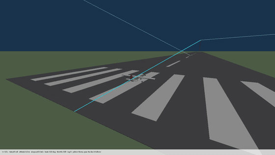

\page bitrl_example_fixed_wing_flight A fixed wing UAV: trim, stability, autopilot, takeoff and landing

\ref bitrl_example_quadrotor_rc_simulation flew a quadrotor, which hovers on its rotors. A fixed
wing aircraft flies on its wing: it has to move through the air to stay up, it turns by banking,
and it needs a runway. This example simulates the Aerosonde, the small UAV of Beard and McLain,
*Small Unmanned Aircraft: Theory and Practice*: a 2.9 m wing, 11 kg, a propeller on an electric
motor, and here a tricycle landing gear. It finds how the aircraft flies level, works out how it
moves about that, designs an autopilot from it, and flies a whole mission: it takes off, flies a
circuit of waypoints and lands back on the runway.

The takeoff and the landing, below 25 m, at twice the speed they ran. The yellow line is the path
flown, the cyan one the line the autopilot follows: the climb out along the runway, and the glide
slope down to the aim point.

## What you need

Nothing for the flight itself; bitrl built with Chrono and Irrlicht to watch it, see
\ref bitrl_install. Chrono only draws: the flight is
\ref bitrl::dynamics::FixedWingDynamics "FixedWingDynamics".

## The aircraft

\ref bitrl::dynamics::FixedWingDynamics "FixedWingDynamics" is a rigid body in 6 degrees of
freedom. Its state is the position in the world (north, east, down), the velocity in the body
(u, v, w), the roll, pitch and yaw, and the body rates (p, q, r). The forces on it are:

- **the air**, from the velocity through the air, which gives the airspeed \f$V_a\f$, the angle
  of attack \f$\alpha\f$ and the sideslip \f$\beta\f$. With \f$\bar q = \frac{1}{2}\rho V_a^2\f$,
  the lift is \f$\bar q S C_L\f$ with \f$C_L = C_{L0} + C_{L\alpha}\alpha\f$ up to the stall, after
  which it falls to that of a flat plate. The drag adds the induced drag,
  \f$C_L^2 / (\pi e A)\f$. The elevator, the pitch rate, the sideslip, the ailerons and the
  rudder each add their coefficient times their value: these are the aircraft's *stability
  derivatives*, in \ref bitrl::dynamics::FixedWingParameters "FixedWingParameters";
- **the propeller**, driven by a DC motor. For a throttle, the motor turns where its torque equals
  the propeller's, and the thrust follows from how far the propeller moves forward each turn. At
  low throttle and high airspeed the air drives the propeller, and it is a drag;
- **gravity**;
- **the wheels**, each a spring and damper while it is below the ground, that rolls along its
  heading and grips sideways. The nose wheel steers with the rudder, the main wheels brake.

It integrates with fourth order Runge-Kutta, in steps of 2 ms on the stiff gear.

| Control | Positive | Limit |
| ------- | -------- | ----- |
| elevator | trailing edge down: the nose pitches down | 0.5 rad |
| aileron | rolls right | 0.5 rad |
| rudder | yaws the nose left, and steers the nose wheel left | 0.5 rad |
| throttle | the motor's voltage, a share of the battery's | 0 to 1 |
| brake | the main wheels | 0 to 1 |

## 1. Trim

An aircraft is *trimmed* when nothing changes: every force and moment balances.
\ref bitrl::dynamics::trim_level_flight "trim_level_flight" finds, for straight and level flight
at an airspeed, the angle of attack, the sideslip, and the four controls that make the six
accelerations zero. It searches with Levenberg-Marquardt steps from the angle of attack whose
lift carries the weight.

Slower, the wing needs a larger angle of attack, and the elevator more up to hold it. Below
16 m/s the elevator cannot, and above 32 m/s the motor cannot pull the aircraft fast enough:
between them is the speed range of the aircraft.

## 2. Stability

\ref bitrl::dynamics::linearise "linearise" works out how the aircraft moves near a trim,
\f$\dot{\delta x} = A\,\delta x + B\,\delta u\f$, and
\ref bitrl::dynamics::flight_modes "flight_modes" splits the eigenvalues of \f$A\f$ into the modes
that every aircraft has:

| Mode | What it is |
| ---- | ---------- |
| short period | the nose bobs up and down at almost the same speed and height: fast and damped |
| phugoid | a slow swap of height and speed: the aircraft climbs, slows, dives and speeds up |
| roll | the roll rate settles after an aileron input: very fast |
| Dutch roll | the nose wags from side to side as the aircraft rocks |
| spiral | a slow wander in bank and heading, often unstable, as here |

The spiral of the Aerosonde grows by \f$e\f$ in 16 s: left alone, it would slowly tip into a
turn. The autopilot is what keeps its wings level.

## 3. The autopilot

\ref bitrl::control::FixedWingAutopilot "FixedWingAutopilot" holds an airspeed, an altitude and a
course with loops one inside the other, each about ten times slower than the loop inside it
(Beard and McLain, chapter 6):

- the course sets a bank, and the bank the ailerons; the rudder holds the sideslip at 0, so the
  turns are coordinated;
- the altitude sets a pitch, the pitch the elevator, and the throttle holds the airspeed. More
  than 15 m below the commanded altitude it climbs at full throttle and the pitch holds the
  airspeed; more than 15 m above, it descends at idle.

Every gain comes from the linear model at 25 m/s: the roll loop, for example, has
\f$\dot p = -a_1 p + a_2 \delta_a\f$ with \f$a_1\f$ and \f$a_2\f$ read from \f$A\f$ and \f$B\f$,
and its gains give it a chosen damping when the aileron reaches its limit at a 20 degree error.

## 4. The mission

\ref bitrl::control::FixedWingMission "FixedWingMission" flies the aircraft from the runway and
back:

1. **takeoff roll**: full throttle, wings level, the nose wheel steering along the centre line;
2. **rotate** at 17 m/s: pitch up to 10 degrees, until the wheels are 8 m up;
3. **enroute**: follow straight lines from the runway to each waypoint in turn, and on to the
   final approach fix. On a line, the course commanded is
   \f$\chi_q - \chi_\infty \frac{2}{\pi}\arctan(k e)\f$, with \f$\chi_q\f$ the line's direction
   and \f$e\f$ the distance right of it: across it far away, along it close to it. The next line
   starts when the aircraft crosses the half plane that bisects the corner;
4. **approach**: down a 4 degree glide slope at 18 m/s, to an aim point 60 m past the threshold;
5. **flare**: below 3 m the pitch holds a sink rate that falls with the height, to 0.3 m/s at the
   ground, and the throttle closes;
6. **rollout**: on its wheels it steers along the centre line, and brakes below 12 m/s until it
   stops.

## Running the example

@code{.sh}
./fixed_wing_flight                  # headless, as fast as it can
./fixed_wing_flight --wind 0 -4      # with a wind of 4 m/s towards the west: a crosswind
./fixed_wing_flight --render         # in a window, in real time
./fixed_wing_flight --record DIR     # and write the takeoff and the landing to DIR
@endcode

It returns 0 if the aircraft stopped on the runway after a touchdown at less than 1.5 m/s.

## Output

@code
1. Trim for straight and level flight
  Va [m/s]  alpha [deg]  elevator [deg]  throttle  trim
      14.0         14.4           -39.2      0.48  no: needs more elevator than it has
      18.0          7.8           -20.8      0.57  yes
      22.0          4.4           -11.4      0.68  yes
      26.0          2.4            -6.0      0.80  yes
      30.0          1.2            -2.6      0.92  yes
      34.0          0.4            -0.3      1.05  no: needs more than full throttle

2. The modes of its motion at 25 m/s
  mode            eigenvalue          wn [rad/s]  damping  period [s]  time constant [s]
  short period  -4.895 +/- 9.870i       11.017    0.444        0.64           0.20
  phugoid       -0.143 +/- 0.478i        0.499    0.286       13.14           7.02
  Dutch roll    -1.551 +/- 5.935i        6.134    0.253        1.06           0.64
  roll          -22.017                 22.017    1.000           -           0.05
  spiral        0.062                    0.062   -1.000           -         -16.04  it grows

3. Autopilot gains, from the linear model at 25 m/s
  roll:      kp 1.429, kd 0.012
  course:    kp 4.646, ki 2.118
  sideslip:  kp 2.941, ki 3.049
  pitch:     kp -2.941, kd -0.569, DC gain 0.516
  altitude:  kp 0.100, ki 0.040
  airspeed:  kp 0.097, ki 0.038 with the throttle; kp -0.512, ki -0.407 with the pitch

4. Takeoff, circuit and landing
  Runway 400 m long, heading 0 deg. The route, north, east and altitude [m]:
       700      0   60
       700    500   80
      -450    500   80
      -700    250   50
      -490      0   39  final approach fix
        60      0    0  aim point
  Wind towards the north 0.0 m/s and the east 0.0 m/s

    t [s]  phase         leg  north [m]  east [m]  alt [m]  Va [m/s]  bank [deg]  off the line [m]
      1.0  takeoff roll    0        5.0      -0.0      0.3       0.1        -0.0               0.0
      3.8  rotate          0       31.1      -0.0      0.3      17.1        -0.1              -0.0  <- rotate
      8.2  enroute         0      132.0      -0.9      8.4      26.6        -0.3              -0.0  <- enroute
     10.0  enroute         0      178.6      -0.3     20.8      25.8        -1.7              -0.3
     20.0  enroute         0      402.9       0.0     60.2      22.3        -0.1               0.0
     40.0  enroute         1      785.5      93.4     80.1      22.4        30.5             -85.5
     60.0  enroute         2      699.7     515.3     79.8      22.1        32.8             -15.1
    ...
    150.3  approach        5     -490.8      -2.5     38.6      22.0        -1.3              -2.3  <- approach
    170.0  approach        5     -144.3      -0.3     14.6      18.0        -0.1              -0.3
    179.0  flare           5       17.5      -0.0      3.3      18.0        -0.0              -0.0  <- flare
    181.6  rollout         5       61.4       0.0      0.3      16.1        -0.0               0.0  <- rollout
    188.4  stopped         5      130.6       0.0      0.3       0.1         0.0               0.0  <- stopped

  Lift-off after a roll of 36.9 m, at 19.6 m/s
  On the last 300 m of the approach: at most 3.25 m off the centre line and 0.10 m off the glide slope
  Touchdown at t = 181.5 s, 61.3 m past the threshold, 0.02 m off the centre line, sinking at 0.77 m/s, at 16.1 m/s
  Stopped at t = 188.4 s, 130.6 m past the threshold, 0.01 m off the centre line
@endcode

- **The takeoff** needs 37 m of runway: the aircraft rotates at 17 m/s and leaves the ground at
  19.6 m/s.
- **The turns** overshoot each line by up to 85 m: the aircraft turns at its 30 degree bank limit,
  a circle of about 85 m radius at 22 m/s, and the half plane switches only at the corner.
- **The approach** starts 2.3 m off the centre line after the last turn, and is within 3.3 m of
  it and 0.1 m of the glide slope over its last 300 m.
- **The touchdown** is 1.3 m past the aim point, on the centre line, sinking at 0.77 m/s: a firm
  but normal landing for a small UAV. The aircraft stops 69 m later.

In a wind, the autopilot flies the course over the ground, so it crabs into a crosswind; the
rudder keeps the sideslip at 0 and the wheels straighten the aircraft at the touchdown:

| Wind towards (north, east) [m/s] | Lift-off roll [m] | Touchdown past the threshold [m] | Off the centre line [m] | Sinking [m/s] | Stopped past the threshold [m] |
| -------------------------------- | ----------------- | -------------------------------- | ----------------------- | ------------- | ------------------------------ |
| (0, 0) | 36.9 | 61.3 | 0.02 | 0.77 | 130.6 |
| (-5, 0), a headwind | 21.5 | 50.2 | 0.03 | 0.74 | 88.5 |
| (0, -4), from the east | 34.2 | 60.0 | 0.06 | 0.83 | 124.9 |
| (0, 4), from the west | 34.4 | 60.2 | 0.11 | 0.77 | 125.2 |

A headwind shortens the takeoff and the rollout, as it should: the aircraft reaches its airspeed
at a lower speed over the ground.

## The library

| Class | What it does |
| ----- | ------------ |
| \ref bitrl::dynamics::FixedWingDynamics "FixedWingDynamics" | the 6-DOF aircraft, its propeller and its landing gear |
| \ref bitrl::dynamics::FixedWingParameters "FixedWingParameters" | its mass, geometry, coefficients and gear; `aerosonde()` |
| \ref bitrl::dynamics::trim_level_flight "trim_level_flight" | the trim for level flight at an airspeed |
| \ref bitrl::dynamics::linearise "linearise" | the linear model about a trim |
| \ref bitrl::dynamics::flight_modes "flight_modes" | the modes of the linear model |
| \ref bitrl::control::FixedWingAutopilot "FixedWingAutopilot" | airspeed, altitude and course hold, with gains from the linear model |
| \ref bitrl::control::FixedWingMission "FixedWingMission" | takeoff, waypoints, approach, flare and rollout |

## Things to try

1. Make `Cn_beta` 0, the aircraft's weathervane stability. What happens to the Dutch roll, and
   can the autopilot still fly the mission?
2. Make the glide slope 6 degrees. How hard does it land, and why?
3. Raise `max_bank` in the autopilot's design to 45 degrees. How much less do the turns overshoot?
4. Add a gust: change the wind for 2 s during the approach. Where does the aircraft touch down?
5. Design the autopilot at 18 m/s instead of 25. Does the approach get better, and the cruise
   worse?

## The code

\include fixed_wing_flight.cpp
