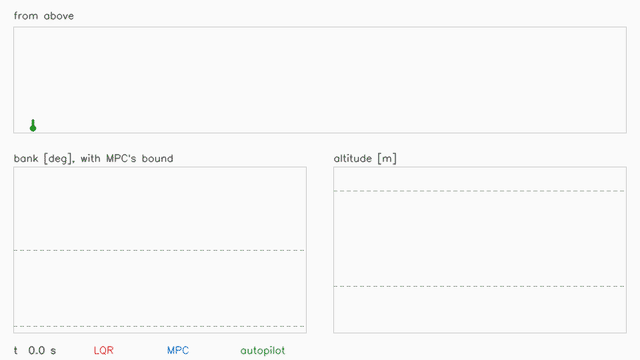

\page bitsim_example_fixed_wing_lqr_mpc Flying a fixed wing aircraft with LQR and MPC

\ref bitsim_example_fixed_wing_flight flies the aircraft with an autopilot of the classic kind: loops closed
one inside the other, roll inside course, pitch inside altitude, each designed on its own from the
linearised aircraft, with limits on the bank and the pitch it commands. This example flies the same aircraft
with two controllers that look at all its states at once, designed on the same linear model: a linear
quadratic regulator (LQR), and model predictive control (MPC), which also knows the limits. All three are
told at 5 s to turn from north to east, 90 degrees at once, and at 30 s to climb 20 m.

## What you need

Nothing beyond bitsim itself. To make the pictures of the GIF, bitsim built with OpenCV. See
\ref bitsim_install.

## The model

The aircraft is the Aerosonde of \ref bitsim_example_fixed_wing_flight,
\ref bitsim::dynamics::FixedWingDynamics "FixedWingDynamics", trimmed for level flight at 25 m/s and 100 m
by \ref bitsim::dynamics::trim_level_flight "trim_level_flight". \ref bitsim::dynamics::linearise "linearise"
gives the linear model about the trim, \f$\dot{\delta x} = A \delta x + B \delta u\f$, with its twelve
states and four controls: elevator, aileron, rudder and throttle. Nothing in the motion depends on the
position north and east, so the controllers leave those two out, and use the other ten: the altitude, the
velocity in the body, the Euler angles and the body rates. The model is discretised for the controllers'
period of 0.05 s.

## The controllers

Both the LQR and MPC weigh the deviations from the trim at the reference, a heading and an altitude, by
Bryson's rule: one over the square of how much of each is acceptable, 0.25 m of altitude, 1 m/s, 0.2 rad of
bank, 0.1 rad of pitch and of heading, 0.5 rad/s, 0.1 rad of each control surface and 0.2 of throttle.

- **The LQR** is the feedback \f$\delta u = -K \delta x\f$ that minimises that cost, from
  \ref bitsim::control::dlqr "dlqr()". It knows nothing about limits.
- **MPC** plans 3 s ahead, 60 steps, with the same cost and the same model,
  \ref bitsim::control::LinearMPC "LinearMPC". It keeps the control surfaces within their limits, the bank
  within 25 degrees and the pitch within 15 degrees of the trim. The bounds on the bank and the pitch are
  soft, with a penalty of 20000, so the plan breaks them only when it cannot keep to them. With no bound
  active, MPC gives the LQR's controls.
- **The autopilot** is \ref bitsim::control::FixedWingAutopilot "FixedWingAutopilot", as in
  \ref bitsim_example_fixed_wing_flight, with its default design: it commands at most 30 degrees of bank
  and 20 of pitch.

## Running the example

@code{.sh}
./fixed_wing_lqr_mpc                 # print what each did
./fixed_wing_lqr_mpc --record frames # and write a picture every 0.1 s to frames/
@endcode

The GIF above is made from the pictures, at three times the speed, with

@code{.sh}
ffmpeg -framerate 30 -i frames/frame_%04d.png \
       -vf "scale=640:-1:flags=lanczos,split[a][b];[a]palettegen=max_colors=32[p];[b][p]paletteuse" \
       fixed_wing_lqr_mpc.gif
@endcode

The example exits with an error unless MPC keeps within its bound on the bank and ends on the heading and
the altitude it was given, so it runs as a test too.

## Output

@code
             max bank   max pitch  turn: heading overshoot  within 2 deg after          lowest  climb: max    within 0.5 m after
LQR          75.0 deg    46.4 deg                 0.0 deg               2.2 s          95.4 m     120.5 m                 2.2 s
MPC          25.1 deg    18.3 deg                 0.0 deg               6.8 s         100.0 m     120.2 m                 3.5 s
autopilot    33.6 deg    19.9 deg                 1.8 deg               6.8 s          99.4 m     122.0 m                 3.5 s

MPC solved 1201 QPs, 0 of them not to the tolerance
@endcode

The LQR does what its cost asks: it turns in 2.2 s, and climbs in 2.2 s, with no overshoot. To do it, it
rolls to 75 degrees and pitches to 46, an aircraft standing on its wing and then on its tail, far outside
the linear model it was designed on. In the turn it loses 4.6 m of altitude, because at 75 degrees of bank
the wing's lift is mostly sideways, and nothing in a linear model about level flight says so.

MPC turns at 25 degrees of bank, the most its bound allows, and takes 6.8 s; it climbs at 15 degrees of
pitch above the trim, 18 in all, in 3.5 s. It does not lose altitude in the turn, and overshoots the climb
by 0.2 m. The autopilot takes as long, and goes past its own limit of 30 degrees, to 34: its
loops limit what they command, not what the aircraft does. It loses 0.6 m in the turn, overshoots the
heading by 2 degrees and the climb by 2 m.

The comparison is with the autopilot's default design, which was not tuned for these steps. What MPC adds
is the limits, kept by the controller itself, with the same weights as the LQR: an LQR that should not bank
beyond 25 degrees would need its weights tuned until it happens not to, for this step and every other.

## Things to try

- Make the bound on the bank 45 degrees. How much faster is the turn?
- Give the LQR a smooth reference instead of steps: the heading turning at 6 degrees a second and the
  altitude climbing at 2 m/s. How steep does it bank then?
- Shorten MPC's horizon to 20 steps, 1 s.

## The library

| Class or function | What it does |
| ----------------- | ------------ |
| \ref bitsim::dynamics::trim_level_flight "trim_level_flight", \ref bitsim::dynamics::linearise "linearise" | the trim of level flight and the linear model about it |
| \ref bitsim::control::discretise "discretise", \ref bitsim::control::dlqr "dlqr" | the discrete model and the LQR |
| \ref bitsim::control::LinearMPC "LinearMPC" | MPC with bounds on the controls and the states |
| \ref bitsim::control::FixedWingAutopilot "FixedWingAutopilot" | the autopilot of fixed_wing_flight |

## The code

\include fixed_wing_lqr_mpc.cpp
