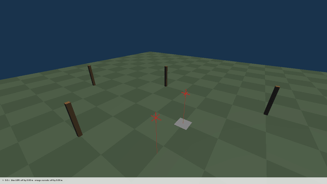

\page bitsim_example_quadrotor_lqr Flying a quadrotor with an LQR

\ref bitsim_example_quadrotor_rc_simulation flies a quadrotor with an angle mode flight controller: the pilot
tilts it, and the controller holds the tilt. To fly it along a path, most drones put a position loop around
such a controller, which works out the tilt and the thrust it needs from where the drone is: a cascade of
loops, each designed on its own. A linear quadratic regulator (LQR) does it in one go instead: it looks at
all twelve states of the drone at once, and works out the thrust and the three torques from all of them.
This example flies both along the same path, and pushes both off it.

## What you need

Nothing beyond bitsim itself to run it. To see it, or to make the pictures of the GIF, bitsim built with
Chrono and Irrlicht. See \ref bitsim_install.

## The drone

It is the quadrotor of \ref bitsim_example_quadrotor_dynamics and \ref bitsim_example_quadrotor_rc_simulation,
\ref bitsim::dynamics::QuadrotorDynamics "QuadrotorDynamics", with some air drag. Its state has twelve
values: the position in the world (NED, z down), the velocity and the angular velocity in the body's axes,
and the Euler angles. Both controllers run at 100 Hz, and the model steps every 1 ms.

## The LQR

The inputs of the LQR are the total thrust and the torques about the three axes, which
\ref bitsim::control::quadrotor_mixer "quadrotor_mixer" turns into the four rotor speeds. The example
linearises one control period of the model, 10 steps with the inputs held, at hover: level, still, with
the thrust carrying the weight. It does it by central differences of the model itself, so the linear
model is that of the simulation, \f$x_{k+1} = A x_k + B u_k\f$ for the deviations from hover.

The weights follow Bryson's rule: each is one over the square of how much of it is acceptable, 0.5 m of
position, 1 m/s, 2 rad/s, 0.3 rad of tilt, 2 N of thrust and 0.05 N m of torque.
\ref bitsim::control::dlqr "dlqr()" gives the gain, a 4 x 12 matrix, and the controller is

\f[
u = u_{hover} - K (x - x_{ref}) ,
\f]

with \f$x_{ref}\f$ the hover at the point of the path where the drone should be, moving at the path's
velocity. The slowest mode of the closed loop halves in 0.29 s.

## The cascade

The other drone flies with
\ref bitsim::control::QuadrotorFlightController "QuadrotorFlightController", whose sticks a PD position
loop moves. From the error of the position and of the velocity, it works out the acceleration it wants:
\f$a = k_p e - k_d \dot e\f$, with \f$k_p = 1\,s^{-2}\f$ and \f$k_d = 1.6\,s^{-1}\f$ along the ground, a
damping of 0.8, and twice that up. The tilt that gives that acceleration sets the pitch and the roll
sticks, and the throttle carries the weight plus the climb. The flight controller then holds the tilt.

## The mission

Both drones start at hover 2 m up and follow a reference that waits 2 s and then moves at 1 m/s along a
square of 4 m, climbing to 3 m and coming back down; the cascade's is the same, 2.5 m to the west. At
22 s, hovering at the end, both are pushed: their velocity changes by 2 m/s to the east.

## Running the example

@code{.sh}
./quadrotor_lqr                      # print the errors
./quadrotor_lqr --render             # and show both, in real time
./quadrotor_lqr --record frames      # and write the window to frames/, ten pictures a second
@endcode

The GIF above is made from the pictures, at twice the speed, with

@code{.sh}
ffmpeg -framerate 20 -i frames/frame_%05d.png \
       -vf "scale=640:-1:flags=lanczos,split[a][b];[a]palettegen=max_colors=64[p];[b][p]paletteuse" \
       quadrotor_lqr.gif
@endcode

The example exits with an error if the LQR does not follow the path or does not recover from the push, so
it runs as a test too.

## Output

@code
LQR designed at hover: the slowest closed loop mode decays by 0.9765 a step, 0.29 s to halve

 time [s]   reference          LQR error [m]   cascade error [m]
      0.0   ( 0.0  0.0  2.0)           0.000               0.000
      4.0   ( 2.0  0.0  2.0)           0.224               0.578
      ...
     18.0   ( 0.0  0.2  2.1)           0.202               0.549
     20.0   ( 0.0  0.0  2.0)           0.037               0.035
     24.0   ( 0.0  0.0  2.0)           0.064               0.493
     28.0   ( 0.0  0.0  2.0)           0.000               0.035

          RMS error along the path [m]   largest error after the push [m]   back within 0.1 m after [s]
LQR                              0.236                              0.634                         1.81
cascade                          0.464                              0.767                         4.46
@endcode

Along the path, the LQR stays about 0.2 m from its reference, the cascade about 0.55 m. Neither gets to
zero while it moves, because of the drag: at 1 m/s the drone has to lean to hold its speed, and its
reference is level. The cascade lags more: with the gains chosen here its position loop is slower than
the LQR. After the push, the LQR is off by at most
0.63 m and back within 0.1 m of its target in 1.8 s; the cascade by 0.77 m, and in 4.5 s.

That is a comparison of two designs, not of the two kinds of controller. The cascade's gains were chosen
by hand, and faster gains would close part of the gap. What the LQR gives is a systematic way to get gains
for all twelve states at once from what matters, the weights, and the tilt, the speeds and the position
are balanced against one another by the same cost.

## Things to try

- Make the LQR's weight on the position 10 times larger. How much closer does it follow the path, and how
  much more does it tilt to do it?
- Give the reference the tilt that holds the drag at 1 m/s, as feedforward, so that \f$x_{ref}\f$ is
  the state the drone is really in when it flies along the path. How much of the error along the path is
  left?
- Tune the cascade's gains until it recovers from the push as fast as the LQR. What happens to its
  error along the path?
- Push harder, at 5 m/s. The LQR was designed at hover and assumes small angles; how far from hover does
  it still work?

## The library

| Class or function | What it does |
| ----------------- | ------------ |
| \ref bitsim::control::dlqr "dlqr" | the gain of a discrete LQR, from the discrete Riccati equation |
| \ref bitsim::control::quadrotor_mixer "quadrotor_mixer" | the rotor speeds for a thrust and three torques |
| \ref bitsim::control::QuadrotorFlightController "QuadrotorFlightController" | the angle mode flight controller of the cascade |
| \ref bitsim::utils::render::QuadrotorView "QuadrotorView" | the window, with the drones, their trails and the targets |

## The code

\include quadrotor_lqr.cpp
