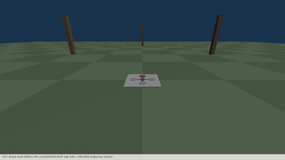

\page bitrl_example_quadrotor_rc_simulation Flying a simulated quadrotor from the laptop

A toy drone is flown with a hand-held transmitter: two sticks for the throttle, yaw, pitch and
roll, sent over a radio to a receiver on the drone, whose flight controller keeps it level and
turns the sticks into rotor speeds. This example puts the laptop in the place of the transmitter
and flies the quadrotor of \ref bitrl_example_quadrotor_dynamics in a simulation: from the keyboard
in a window, or headless along a scripted flight. It is the first step to flying a real toy drone
from the laptop: the commands are those its radio carries.

The scripted flight, at twice the speed it ran: take off, fly 5 m forward, turn round, fly back
and land. The red rotor is the front one, the yellow line the track over the floor.

## What you need

bitrl built with Chrono and Irrlicht, which draw the drone; see \ref bitrl_install. The flight
itself is QuadrotorDynamics, not Chrono.

## From the sticks to the rotors

| Piece | Where | What it does |
| ----- | ----- | ------------ |
| \ref bitrl::control::RCCommand "RCCommand" | bitrl | the throttle in [0, 1], yaw, pitch and roll in [-1, 1], and whether the motors are armed |
| \ref bitrl::utils::render::KeyboardRC "KeyboardRC" | bitrl | the keyboard of the window as the sticks |
| \ref bitrl::boards::RCTransmitterBase "RCTransmitterBase" | bitrl | sends the commands; a backend decides where to |
| \ref bitrl::boards::SIM_RCLink "SIM_RCLink" | bitrl | the radio to a simulated drone, with the receiver's failsafe |
| \ref bitrl::control::QuadrotorFlightController "QuadrotorFlightController" | bitrl | the drone's flight controller in angle mode, and its motor mixer |
| \ref bitrl::dynamics::QuadrotorDynamics "QuadrotorDynamics" | bitrl | flies the drone |
| `SimulatedQuadrotor` | the example | the receiver, the flight controller and the dynamics together, and the floor |

The transmitter sends a command every 20 ms. The receiver passes the latest one to the flight
controller at every step of 1 ms; if it has heard nothing for 0.5 s it goes into **failsafe** and
disarms the drone, so that its motors stop, as a toy drone does when it flies out of range.

### Angle mode

The flight controller of a toy drone flies in *angle mode*:

- the **throttle** sets the thrust, as a share of the most the rotors can give. Here they can lift
  twice the weight, so the drone hovers at a throttle of 0.5. There is no height hold: the pilot
  holds the height, and tilting the drone takes some of the thrust off the weight, cos 15 degrees
  of it at 15 degrees, so the pilot adds a little throttle while flying forward;
- the **roll and pitch** sticks set the angle to tilt to, up to 25 degrees; letting them go levels
  the drone. A PD controller on each angle gives the torque,
  \f$\tau = J(\omega_n^2 (\phi_{sp} - \phi) - 2\zeta\omega_n p)\f$, with \f$\omega_n\f$ = 12 rad/s
  and \f$\zeta\f$ = 0.8. A tilted drone accelerates the way it tilts, until the air drag of the
  model, 0.25 kg/s, holds it at a steady speed;
- the **yaw** stick sets the rate of turn, up to 120 deg/s.

The **mixer** turns the thrust and the three torques into the four rotor speeds, by inverting the
equations of \ref bitrl_example_quadrotor_dynamics; a rotor cannot push down, nor spin faster than
its motor allows. The flight controller reads the attitude and the rates of the drone directly; a
real one estimates them from its IMU, as \ref bitrl_example_imu_heading does for a heading.

### The floor

QuadrotorDynamics knows nothing of a floor, so `SimulatedQuadrotor` keeps the drone on it: there
it stands still and level. A touchdown faster than 1 m/s counts as a hard landing.

## Flying it

@code{.sh}
./quadrotor_rc_simulation --render                # fly it from the keyboard
./quadrotor_rc_simulation                         # the scripted flight, headless
./quadrotor_rc_simulation --render --script       # watch the scripted flight
./quadrotor_rc_simulation --failsafe              # the transmitter stops at 7 s
@endcode

| Key | Stick |
| --- | ----- |
| Space | arm, or disarm |
| W, S | throttle up, down; it stays where it is left |
| A, D | yaw left, right |
| Up, Down | pitch forward, back |
| Left, Right | roll left, right |
| R | start again |

Arm it, hold W until the throttle passes 0.5 and it lifts off, and let go when it climbs: the
status bar at the bottom shows the throttle and the hover throttle. The camera follows behind the
drone. `--record DIR` writes the window to `DIR`, as in \ref bitrl_example_line_following_infrared_sonar;
the movie above was made with `--render --script --record frames`.

## Output

The scripted flight, headless. It returns 0 if the drone took off, came back within a metre of the
start, landed gently and never tilted beyond the 25 degrees the sticks allow.

@code
Quadrotor: 0.47 kg, arms 0.23 m, rotors up to 878 rad/s, hover throttle 0.50
Radio: a command every 20.00 ms, failsafe after 0.50 s without one
Flying the script

    t [s]   x [m]   y [m]  height [m]  roll  pitch  heading [deg]  throttle  phase
      0.0    0.00    0.00        0.00   0.0    0.0            0.0      0.00  on the floor
      1.0    0.00    0.00        0.00   0.0    0.0            0.0      0.00  arm
      2.0    0.00    0.00        0.50   0.0    0.0            0.0      0.56  take off
      3.0    0.00    0.00        1.47   0.0    0.0            0.0      0.45  level off
      4.0    0.00    0.00        1.57   0.0    0.0            0.0      0.50  hover
      5.0    0.15    0.00        1.57   0.0  -15.2            0.0      0.52  forward
      6.0    1.91    0.00        1.63   0.0  -15.0            0.0      0.52  forward
      7.0    4.65    0.00        1.72   0.0   15.3            0.0      0.52  brake
      8.0    4.91    0.00        1.83   0.0   15.0            0.0      0.52  brake
      9.0    3.19    0.01        1.91  -0.0   -0.3           45.1      0.50  turn round
     10.0    1.84    0.03        1.95   0.0    0.0          164.6      0.50  turn round
     11.0    0.22    0.06        2.04  -0.0  -15.0          182.1      0.52  forward
     12.0   -2.75    0.01        2.12   0.0  -15.0          182.1      0.52  forward
     13.0   -4.89   -0.04        2.25   0.0   15.0          182.1      0.52  brake
     14.0   -4.14    0.01        2.37   0.0   15.0          182.1      0.52  brake
     15.0   -2.49    0.08        2.43   0.0    0.0          182.1      0.50  hover
     16.0   -1.50    0.13        2.42   0.0    0.0          182.1      0.48  land
...
     21.0   -0.22    0.18        0.00   0.0    0.0          182.1      0.48  land
...
Highest 2.45 m, furthest 5.13 m from the start, most tilt 15.4 deg
Ended on the floor, 0.29 m from the start; touched down at 0.69 m/s; hard landings: 0
@endcode

A pitch stick of 0.6 tilts the drone by 0.6 x 25 = 15 degrees, nose down to fly forward, nose up
to brake. Full yaw for 1.5 s turns it by 182 degrees, a little more than the 180 the sticks ask
for, as the rate loop lags. The drone ends 0.29 m from where it took off and touches down at 0.69
m/s. It climbs from 1.6 to 2.4 m along the way: the extra throttle for the tilt is a guess, as it
is for a pilot.

With `--failsafe` the transmitter falls silent at 7 s, while the drone brakes 1.7 m up:

@code
      7.0    4.65    0.00        1.72   0.0   15.3            0.0      0.52  brake
      7.5    5.13    0.00        1.78   0.0   15.0            0.0      0.00  FAILSAFE
      8.0    5.24    0.00        0.61   0.0   15.0            0.0      0.00  FAILSAFE
      8.5    5.26    0.00        0.00   0.0    0.0            0.0      0.00  FAILSAFE
Ended on the floor, 5.26 m from the start; touched down at 5.16 m/s; hard landings: 1
@endcode

Half a second later the receiver disarms the drone. With its motors stopped nothing levels it, and
it falls, still tilted, onto the floor at 5 m/s. Cutting the motors is what a toy drone does; a
safer failsafe would level the drone and lower it slowly while it still can.

## Things to try

1. Fly the scripted flight's square by hand, and land on the white pad.
2. Give the flight controller tilt compensation: divide the thrust by
   \f$\cos\phi\cos\theta\f$. Does the drone still climb while flying forward?
3. Make the failsafe of `SIM_RCLink` level the drone and land it at 0.5 m/s instead of stopping
   the motors.
4. Lower `attitude_frequency` to 4 rad/s. How does the drone answer the sticks?
5. Add a height hold: a PI controller on the height, with the throttle stick setting the rate of
   climb instead of the thrust.

## The code

\include quadrotor_rc_simulation.cpp
