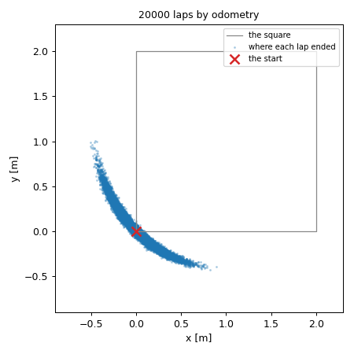

\page bitsim_example_parallel_monte_carlo Dead reckoning drift, on all the cores

\ref bitsim_example_wheel_odometry showed that odometry drifts. How far? The errors are random, so
the answer is a distribution, and the simplest way to get it is Monte Carlo: simulate many laps,
each with its own random errors, and look at where they end. The laps are independent, so they
can run on all the cores at once.

## What you need

Nothing beyond bitsim itself. See \ref bitsim_install.

## One lap

A differential drive robot drives a square of 2 m sides at 0.5 m/s and turns on the spot at the
corners, a quarter turn a second, integrated every 10 ms with
\ref bitsim::dynamics::DiffDriveDynamics "DiffDriveDynamics". Without errors it ends where it
started. With errors:

- every step its speed is 5 % off at random, as its wheels slip;
- every step its turn rate is off by a random 0.05 rad/s;
- for the whole lap its turn rate has a bias, drawn once per lap with a standard deviation of
  0.01 rad/s, as a gyroscope or a wheel a little larger than the other would give.

## Many laps, in parallel

@code{.cpp}
End lap(uint_t run)
{
    std::mt19937 rng(task_seed(SEED, run)); // every lap its own errors
    ...
}

const auto ends = parallel_map(n_runs, lap); // ends[i] = lap(i), on every core
@endcode

Each lap has its own generator, seeded from its index with `task_seed()`, and writes only its own
result, so the laps need no lock. `parallel_map` returns the results in the order of the laps, so
they are the same however many threads ran them: the example runs the laps once in a plain loop
and once on the default pool, and compares every end.

## Running the example

@code{.sh}
./parallel_monte_carlo [--runs 20000]
@endcode

It writes `final_positions.csv`, the end of every lap, the points of the picture above.

## Output

@code
1. One lap without errors
  the robot ends 3.96019e-14 m from where it started: back at the start, but for rounding

2. 20000 laps with errors
  on one thread: 2.60 s; on 8 threads of the pool and this one: 0.69 s, a speed-up of 3.74
  every run ended in the same place on both: true

3. Where the robot ends up
      runs   mean error [m]   rms error [m]   95 % within [m]   mean end [m]
       100            0.194           0.250             0.507   (0.021, 0.012)
      1000            0.220           0.278             0.540   (0.017, 0.020)
     10000            0.231           0.288             0.564   (0.014, 0.025)
     20000            0.230           0.286             0.561   (0.012, 0.026)
@endcode

The laps took 3.7 times less time on a laptop with four cores and two threads per core; the times
change from run to run, the ends do not. With `BITSIM_NUM_THREADS` set to 2, 4 and 8 the speed-up
was about 2.4, 3.0 and 3.9: the pool's threads and the calling thread together, on four cores whose
second threads add less than a core.

After one lap the robot is 23 cm from its start on average, and within 56 cm in 95 % of the laps.
The picture shows why the spread is an arc and not a disc: the bias of the turn rate turns the whole
square a little, and the robot ends on an arc around the middle of the square. The speed errors
of the steps mostly average out over the 2000 steps of a lap. A hundred laps already give the
error to within a few centimetres; the 95 % bound needs more, since few laps fall that far.

## Things to try

1. Set the bias to 0. How much smaller is the error, and what shape is the cloud now?
2. Drive the square twice. Does the error double?
3. Run with `BITSIM_NUM_THREADS=1`, 2 and 4, and plot the time against the threads.

## The code

\include parallel_monte_carlo.cpp
