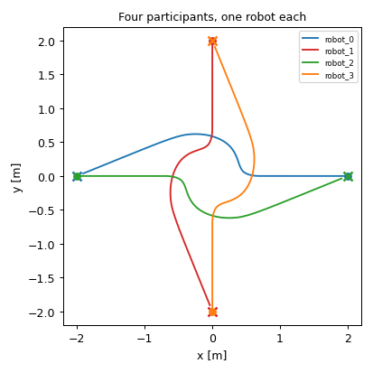

\page bitsim_example_distributed_robots Robots simulated by separate participants

A simulation of many robots can outgrow one process, or one machine, or it can mix simulated
robots with real ones. bitsim's `bitsim/distributed` splits it up: every *participant* simulates
its own robots, and the participants tell each other, every so often, where their robots are.
Here four differential drive robots cross a circle to the opposite point, each simulated by a
participant of its own with bitsim's diff-drive kinematics, and each steers around the robots it
hears of.

## What you need

Nothing beyond bitsim itself for the threads of one process. For processes, bitsim built with
MQTT and a broker such as mosquitto. See \ref bitsim_install.

## The pieces

| | What it does |
| --- | --- |
| \ref bitsim::distributed::BodyState "BodyState" | where a body is, how it moves, and how big it is |
| \ref bitsim::distributed::StateMessage "StateMessage" | what a participant sends: its bodies at a step, encoded in MessagePack |
| \ref bitsim::distributed::Transport "Transport" | how the messages travel: `InProcessBus` between threads, `MQTT_Transport` between processes, `LossyTransport` to add delays and losses |
| \ref bitsim::distributed::Synchroniser "Synchroniser" | every sync period, sends this participant's bodies and returns what it knows of the others |

A participant's loop is always the same:

@code{.cpp}
Synchroniser sync(transport, "robot_2", config); // config.peers: the other participants
for (uint_t step = 0; ...; ++step)
{
    const auto &peers = sync.exchange(step, {BodyState::planar("chassis", x, y, theta, ...)});
    // steer with what peers says of the others, then simulate up to the next exchange
}
sync.leave();
@endcode

## Lockstep and wall clock

`SynchroniserConfig::mode` decides how the participants keep time.

**Lockstep.** `exchange(step)` returns once every peer has sent the same step. The simulation
runs as fast as its slowest participant, and it is repeatable: a robot's controller sees the
others exactly as they were at the step, whatever the network did. While it waits, a participant
sends its last two steps again every `resend_period`, so a lost message, or a participant that
connected late, only costs time. No participant can be more than one step ahead of another, so
two steps are enough.

**Wall clock.** Every participant keeps pace with the wall clock, `real_time_factor` simulated
seconds per second, and uses the newest state of each peer, moved forward by its age. Nobody
waits, so a real robot, which cannot wait, can take part; see
\ref bitsim_example_hardware_in_the_loop_sync. The price is that the result depends on the delays.

## Running the example

@code{.sh}
./distributed_robots                 # four threads: lockstep, lockstep over a bad network, wall clock
for k in 0 1 2 3; do ./distributed_robots --transport mqtt --participant $k & done; wait
@endcode

The second line runs every robot in a process of its own, meeting on the broker at
`tcp://localhost:1883` (`--broker` for another). They can be on different machines.

## Output

@code
1. In lockstep
  4 of 4 robots arrived, the last after 10.00 s of simulated time, in 0.04 s; closest centres 0.61 m
  0 times a robot sent its last steps again; the longest wait for the others 0.004 s
  a second run gives the same paths: true

2. In lockstep, over a network that delays and loses
  4 of 4 robots arrived, the last after 10.00 s of simulated time, in 4.62 s; closest centres 0.61 m
  537 times a robot sent its last steps again; the longest wait for the others 0.099 s
  10 % of the messages lost, 5 ms of latency; the paths are the same as in 1

3. In wall-clock mode, over the same network
  4 of 4 robots arrived, the last after 10.15 s of simulated time, in 2.54 s; closest centres 0.60 m
  0 steps started more than a period late; the latest 0.000 s
  at 4.0 times real time; the paths differ from run to run
@endcode

In lockstep the paths are the same every time, and the same when a tenth of the messages are lost:
the losses only cost time. Run as four MQTT processes, the paths are the same to the last bit as
the paths of the threads. In wall-clock mode the robots see each other a little late, and the
crossing takes a little longer.

### A note on MQTT brokers

With mosquitto's default settings, the 200 steps of the four processes took 7.9 s; with
`set_tcp_nodelay true` in `mosquitto.conf` they took 0.09 s. By default the broker waits a few
milliseconds to bundle small TCP packets (Nagle's algorithm), and a lockstep that waits for every
message pays that wait at every step. Turn it off on a broker that serves a distributed simulation.

## Things to try

1. Run 8 robots (`--robots 8`). How does the time of the lockstep run change, and why?
2. Run the wall-clock mode with `--latency 0.2`. When do the robots start to bump into each other?
3. Start the four MQTT processes a few seconds apart. What does the first one do until the last
   has started?

## The code

\include distributed_robots.cpp
