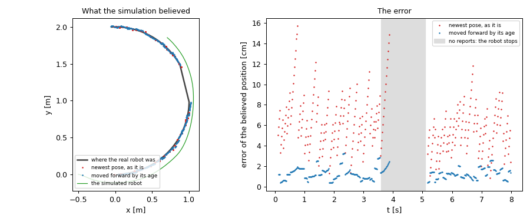

\page bitsim_example_hardware_in_the_loop_sync A simulation that keeps up with a real robot

A real robot cannot wait for a simulation, so a simulation with a real robot in it cannot run in
lockstep. In wall-clock mode a participant keeps pace with the wall clock instead, and uses the
newest state it has of every other participant, whenever it came. This example drives a simulated
robot that follows a real one, 0.5 m behind it.

The black line is where the real robot was, except during the 1.5 s without reports, which it
crosses in a straight line; the dots are where the simulation believed it was.

## What you need

Nothing beyond bitsim itself in one process. For two processes, bitsim built with MQTT and a
broker. See \ref bitsim_install.

## The real robot

The real robot here is a thread that drives a circle of 1 m radius at 0.4 m/s, in real time, and
reports its measured pose ten times a second, with 1 cm of noise. Its reports reach the simulation
over a network, a \ref bitsim::distributed::LossyTransport "LossyTransport", that delays them by
80 ms, give or take 20 ms, and loses one in ten. For 1.5 s in the middle the reports stop.

A report is a \ref bitsim::distributed::StateMessage "StateMessage", stamped with the wall-clock
time it was measured. That is all a real robot has to send, and it needs nothing else of bitsim:

@code{.cpp}
StateMessage m;
m.participant = "robot";
m.stamp = wall_time_now(); // seconds since the epoch of the system clock
m.bodies.push_back(BodyState::planar("chassis", x, y, theta, vx, vy, w, {0.4, 0.3, 0.1}));
transport.publish(m.encode()); // MQTT topic bitsim/world/<world>
@endcode

The stamp is how the simulation tells how old a report is, so the clocks of the robot and of the
simulation's machine must agree, to a few milliseconds. On a network that means NTP, or chrony.

## The simulation

The simulation steps 50 times a second with a \ref bitsim::distributed::Synchroniser
"Synchroniser" in `SyncMode::WALL_CLOCK`. At every step `exchange()` returns the newest report of
the robot, with its `age`, and, with `extrapolate` set, the pose moved forward by the robot's
velocities for that age. A report older than `stale_after`, 0.4 s, is `stale`: the simulated robot
stops until a new one comes.

## Running the example

@code{.sh}
./hardware_in_the_loop_sync              # in one process, with and without moving the pose forward
./hardware_in_the_loop_sync --transport mqtt --role sim &
./hardware_in_the_loop_sync --transport mqtt --role robot
@endcode

With MQTT, the robot's side is what a real robot replaces.

## Output

@code
1. Moving the pose forward by its age
  extrapolated: error of the believed pose 0.013 m on average, at most 0.033 m; mean age 0.148 s
    70 of 400 steps stale, the robot stopped for 1.40 s; closest to the real robot 0.50 m; 0 steps started late

2. Using the newest pose as it is
  newest: error of the believed pose 0.061 m on average, at most 0.157 m; mean age 0.148 s
    69 of 400 steps stale, the robot stopped for 1.38 s; closest to the real robot 0.50 m; 0 steps started late
@endcode

A report is 0.15 s old on average when the simulation uses it: 80 ms of latency, half of the 0.1 s
between reports, and the reports that were lost. In 0.15 s the robot drives 6 cm, and that is the
error of the newest report used as it is. Moved forward with the robot's velocities, the error is
1.3 cm, about the noise of the measurement. The motion is a circle, and moving forward assumes
constant velocities, which is why the error grows during the 0.4 s before a pose is stale.

When the reports stop, the simulated robot stops 0.4 s later, and goes on when they come back.

## Things to try

1. Set `stale_after` to 2 s. How far off is the believed pose at the end of the dropout?
2. Make the robot report five times a second. Which error grows, and by how much?
3. `BodyState::extrapolated()` turns the heading with the turn rate, but moves the position along
   a straight line. Move it along the arc instead: how much smaller is the error before a pose goes
   stale?

## The code

\include hardware_in_the_loop_sync.cpp
