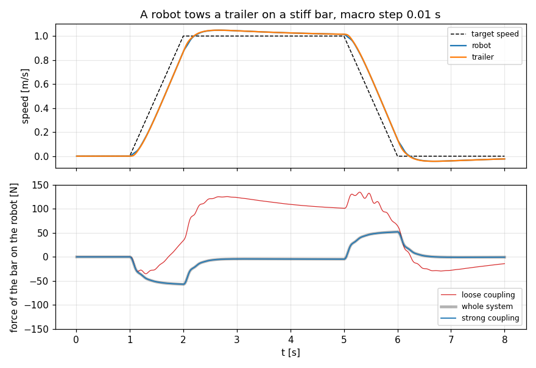

\page bitsim_example_distributed_towing A robot and its trailer, co-simulated in two processes

A robot tows a trailer on a stiff tow bar. The robot, with its speed controller, is one subsystem;
the trailer and the bar are another. Each runs in a participant of its own, a thread or a process
on any machine that reaches an MQTT broker, and every macro step they exchange the motion of the
hitch and the force of the bar, repeating the step until the two agree. The result is that of the
same co-simulation in one process, to the last bit.

## What you need

Nothing beyond bitsim for the threads of one process. For two processes, bitsim built with MQTT and
a broker such as mosquitto; see \ref bitsim_install.

## The subsystems

| Subsystem | State | Inputs | Outputs |
| --------- | ----- | ------ | ------- |
| robot, 20 kg | position, speed, and the integral of its speed error | the force of the bar | the hitch: position and speed |
| trailer, 50 kg, and the bar | position and speed | the hitch: position and speed | the force of the bar on the robot |

The robot's PI controller pushes with at most 150 N to follow a speed that rises to 1 m/s, holds,
and falls back to 0. The bar is 0.5 m long, with a stiffness of 20 kN/m: it barely stretches, and
that is what makes the coupling hard.

## Every subsystem a participant

\ref bitsim::cosim::CoSimParticipant "CoSimParticipant" runs the strong coupling of
\ref bitsim_example_two_mass_oscillator with one subsystem per participant:

@code{.cpp}
CouplingLayout layout;                       // the same on every participant
layout.add("robot", 1, 2);
layout.add("trailer", 2, 1);
layout.connect("robot", 0, "trailer", 0);
layout.connect("robot", 1, "trailer", 1);
layout.connect("trailer", 0, "robot", 0);

MQTT_Transport transport(broker, "distributed_towing");
CoSimParticipant me(layout, "robot", *robot, transport, coupling);
me.initialise();
for (...)
    me.step(H);
me.leave();
@endcode

Every try of a macro step, a participant steps its own subsystem, sends its outputs, and waits for
those of the other, with bitsim's \ref bitsim::distributed::Synchroniser "Synchroniser" in lockstep.
Then each participant has the outputs of both. From the layout, which both share, each works out
the inputs of both subsystems, how far they moved, and whether to try again, so the two decide
alike without another message. Both run the same `jacobi_step()` as
\ref bitsim::cosim::CoSimulation "CoSimulation" does in one process, with the same numbers, so they
get its result to the last bit.

## Running the example

@code{.sh}
./distributed_towing                     # in one process, then two threads on an in-process bus
./distributed_towing --transport mqtt --participant robot &
./distributed_towing --transport mqtt --participant trailer; wait
@endcode

`--macro-step` sets the macro step (0.01 s), `--broker` the broker (tcp://localhost:1883), and
`--loose` couples the two processes loosely.

## Output

@code
A robot tows a trailer on a stiff bar for 8 s, macro step 0.010 s

1. In one process: the force of the bar [N]
                          largest force   largest error   tries per step
   whole system, one solver         57.0
   loose coupling                  134.7           130.4              1.0
   strong coupling                  56.9          0.1903             12.1
   strong steps that did not converge: 0

2. The robot and the trailer in participants of their own, threads on a bus
   9663 tries in 0.596 s: 62 microseconds a try for the exchange and the step
   the largest bar force -56.860307151 N
   both saw the bar force of the one process at every step, to the last bit: true
@endcode

As two processes over mosquitto, on this laptop:

@code
robot: 800 macro steps, 9663 tries, in 1.27 s, 131 microseconds a try; the largest bar force -56.860307151 N
trailer: 800 macro steps, 9663 tries, in 1.26 s, 130 microseconds a try; the largest bar force -56.860307151 N
@endcode

The processes took the same 9663 tries as the threads, and saw the same forces.

Loosely coupled, the bar force is wrong by up to 130 N, more than twice the largest true force, and
while the robot cruises it is wrong all the time. That is not noise: with its inputs held, the
trailer sees the hitch where it was at the start of the step, 1 cm behind where it is at 1 m/s and
0.01 s, and the bar turns 1 cm into 200 N. The stiffer the coupling and the faster the robot, the
larger the error. The speeds look almost right, since the error is a force that the robot's
controller mostly cancels, which is why such errors go unnoticed. Strongly coupled, the force is
within 0.2 N of the whole system everywhere, for 12 tries per step.

Every try costs a round trip: 62 microseconds between threads, and 131 through mosquitto with
`set_tcp_nodelay true`. Without it mosquitto delays small messages by about 40 ms, and a strong
step would take half a second. Strong coupling across processes pays off for subsystems whose steps
cost more than a round trip: a physics engine, a detailed model of a motor, or a tool of its own.

## Things to try

1. Run the two processes with `--loose`. How long do they take, and what is the largest force?
2. Halve the macro step. How many tries does a strong step take, and how large is the loose error?
3. Make the bar 10 times stiffer. Up to which macro step does loose coupling stay stable?

## The code

\include distributed_towing.cpp
