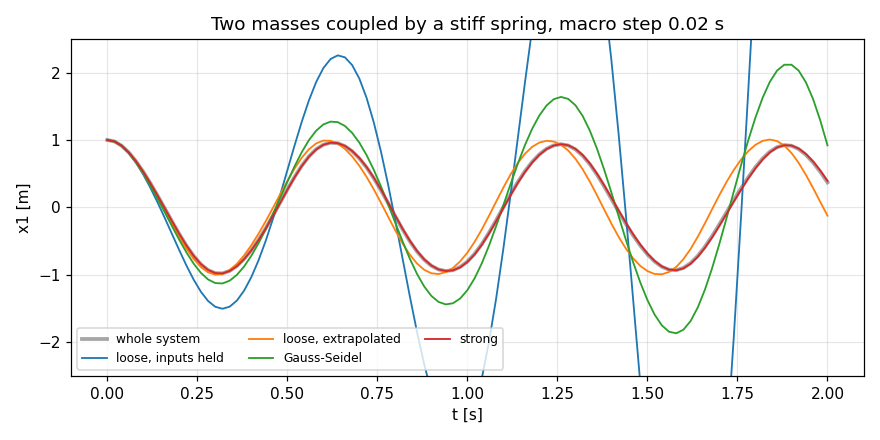

\page bitsim_example_two_mass_oscillator Two masses on a stiff spring, co-simulated

A *co-simulation* splits a system into subsystems, each simulated by its own solver, which meet
only every *macro step* to exchange the variables that couple them: forces one way, motions the
other. That lets a robot simulated in one tool drive a load simulated in another, or each part of a
system run in a process or on a machine of its own. The price is that between two meetings each
subsystem only guesses what the others do.

Here two masses joined by a stiff spring are split into two subsystems, the benchmark of
co-simulation, and simulated with three ways of coupling them, against the whole system integrated
by one solver.

## What you need

Nothing beyond bitsim.

## The system

Mass 1 hangs on a soft spring, mass 2 on a stiff one, and a stiff spring with a little damping
joins them. The split is the usual *force-displacement* coupling:

| Subsystem | State | Inputs | Outputs |
| --------- | ----- | ------ | ------- |
| mass 1 | \f$x_1, v_1\f$ | the force of the coupling spring on mass 1 | \f$x_1, v_1\f$ |
| mass 2 | \f$x_2, v_2\f$ | \f$x_1, v_1\f$ | the force of the coupling spring on mass 1 |

The coupling spring belongs to mass 2, so its output, \f$k_c (x_2 - x_1) + d_c (v_2 - v_1)\f$,
depends on its inputs directly: a *direct feedthrough*. Each subsystem is an
\ref bitsim::cosim::OdeSubsystem "OdeSubsystem", given by its equations and integrated with 10
Runge-Kutta steps per macro step:

@code{.cpp}
auto mass_1 = std::make_unique<OdeSubsystem>(
    vec{1.0, 0.0}, 1, 2,                                     // x0, 1 input, 2 outputs
     { return vec{x[1], (-K1 * x[0] + u[0]) / M1}; },
     { return vec{x[0], x[1]}; });

CoSimulation cs(config);
cs.add("mass 1", *mass_1);
cs.add("mass 2", *mass_2);
cs.connect("mass 1", 0, "mass 2", 0);   // x1
cs.connect("mass 1", 1, "mass 2", 1);   // v1
cs.connect("mass 2", 0, "mass 1", 0);   // the force on mass 1
cs.initialise();                        // the inputs at t = 0, through the feedthrough
for (...)
    cs.step(H);
@endcode

## Loose and strong coupling

\ref bitsim::cosim::CoSimulation "CoSimulation" is the *master algorithm*: it steps the subsystems
and passes the outputs of each to the inputs of the others. Over a step from \f$t_n\f$ to
\f$t_{n+1}\f$ a subsystem's inputs move in a straight line from those at \f$t_n\f$ to a guess of
those at \f$t_{n+1}\f$. `CouplingConfig` decides how:

- **Loose coupling, inputs held** (Jacobi): both subsystems step at the same time, the guess being
  the inputs at \f$t_n\f$. Each sees the other frozen for the whole step.
- **Loose coupling, extrapolated**: the guess is the straight line through the inputs at
  \f$t_{n-1}\f$ and \f$t_n\f$.
- **Gauss-Seidel**: mass 1 steps first, with its inputs held; mass 2 then steps with the outputs of
  mass 1 at \f$t_{n+1}\f$.
- **Strong coupling**: Jacobi, repeated. After a try, the outputs give the inputs they imply; if
  those differ from the guess by more than a tolerance, every subsystem goes back to the state it
  saved and tries again, with the new inputs. When they agree, the two subsystems have stepped
  together, as one system would.

## Output

@code
1. The error of x1 at t = 2 s, against the whole system with one solver

   macro step [s]     loose, inputs held    loose, extrapolated           Gauss-Seidel                 strong   tries per strong step
           0.0400               8.47e+01               3.30e+00               2.47e+00               8.59e-02                    18.9
           0.0200               9.04e+00               4.94e-01               5.49e-01               2.21e-02                    14.7
           0.0100               1.30e+00               1.11e-01               1.90e-01               5.57e-03                    11.2
           0.0050               3.61e-01               2.74e-02               8.06e-02               1.40e-03                     9.8
           0.0025               1.39e-01               6.88e-03               3.73e-02               3.49e-04                     9.0

2. A macro step of 0.05 s, for 5 s: the largest |x1|; it starts at 1
     loose, inputs held     4.42e+05   unstable
    loose, extrapolated          596   unstable
           Gauss-Seidel          136   unstable
                 strong        0.973

3. The two subsystems on two threads
   strong coupling gives the same x1 at every step, to the last bit: true
@endcode

x1 starts at 1 m, so an error of 1 is as large as the motion itself. Held inputs give errors that
shrink only slowly with the macro step, and wrong answers down to a few milliseconds. Extrapolating
and Gauss-Seidel are better, but strong coupling is a different class: its error falls by 4 every
time the macro step halves, second order, and it is 20 to 30 times smaller than the best loose
scheme at the same step. With a macro step of 0.05 s, a quarter of the period of the stiff mode,
every loose scheme feeds energy into the spring until it blows up; strong coupling stays stable.

A strong step costs 9 to 19 tries with this tolerance, \f$10^{-12}\f$. A looser tolerance takes
fewer, and a strong step with a long macro step can still be cheaper than loose coupling with the
macro step that its accuracy would need.

The subsystems of a try do not depend on each other, so `set_pool()` steps them on threads; the
result is the same to the last bit. \ref bitsim_example_distributed_towing puts each subsystem in a
process of its own.

## Running the example

@code{.sh}
./two_mass_oscillator [--csv oscillator.csv]
python examples/13_co_simulation/two_mass_oscillator/plot.py oscillator.csv two_mass_oscillator.png
@endcode

## Things to try

1. Set the tolerance of the strong scheme to \f$10^{-6}\f$. How many tries does a step take, and how
   much does the error grow?
2. Give mass 1 the coupling spring instead, so that mass 1 outputs the force and mass 2 its motion.
   Which loose scheme suffers most?
3. Set `relaxation` to 0.5. Does the strong scheme take more tries, or fewer?

## The code

\include two_mass_oscillator.cpp
