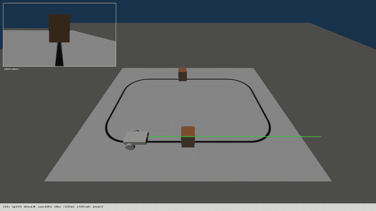

\page bitrl_example_32 BitRL Example 32: Following a line with infrared sensors and avoiding obstacles

In \ref bitrl_example_31 the robot saw the line with a camera. Most small line following robots
do it with something much simpler: a few infrared elements that look straight down at the floor.
Here the differential drive robot of \ref bitrl_example_14 gets three of them, and an ultrasonic
sensor on its front that measures how far away the nearest obstacle ahead is. It drives around a
track, a dark line on light paper, and two boxes stand on the line. The robot follows the line,
drives around each box, and comes back to the line behind it.

The robot also carries a camera that looks ahead. It does nothing but show, in the corner of the
window, what is in front of the robot; the robot does not use it.

One lap, at twice the speed it ran. The line from the front of the robot is the sonar's beam: green,
or red when an obstacle is close. The robot's camera image is in the top left corner.

## What you need

bitrl built with Chrono, Irrlicht and OpenCV, see \ref bitrl_install. OpenCV draws the track;
nothing reads a stream, so any OpenCV will do. The example needs no network, broker or board.

## The pieces

| Piece | Where | What it does |
| ----- | ----- | ------------ |
| \ref bitrl::sensors::InfraredSensor "InfraredSensor" | bitrl | infrared elements that tell the colour of the floor under them |
| \ref bitrl::sensors::backends::CHRONO_InfraredBackend "CHRONO_InfraredBackend" | bitrl | simulated elements: each reads the floor below where the body carries it |
| \ref bitrl::sensors::backends::MQTT_InfraredBackend "MQTT_InfraredBackend" | bitrl | real elements on a board that publishes their readings over MQTT |
| \ref bitrl::sensors::UltrasonicSensor "UltrasonicSensor" | bitrl | measures the distance to the nearest obstacle ahead |
| \ref bitrl::sensors::backends::CHRONO_UltrasonicBackend "CHRONO_UltrasonicBackend" | bitrl | a simulated sensor: casts rays into the Chrono world |
| \ref bitrl::sensors::backends::MQTT_UltrasonicBackend "MQTT_UltrasonicBackend" | bitrl | a real sensor on a board that publishes over MQTT |
| \ref bitrl::sensors::FloorImage::reflectance "FloorImage::reflectance" | bitrl | how bright a picture of the floor is at a point: what an element sees there |
| \ref bitrl::rb::bitrl_chrono::CHRONO_DiffDriveRobot "CHRONO_DiffDriveRobot" | bitrl | the robot, with both sensors read from the robot file |
| `LineFollower`, `Driver` | `example_32.cpp` | follow the line, go around the boxes |

## The sensors

### Infrared elements

An infrared reflectance element, such as a TCRT5000, has an infrared LED and a photo transistor
side by side. The LED shines at the floor a few millimetres below, and the transistor measures
how much light comes back. White paper reflects most of it and a black line very little. A board
reads the transistor with an ADC; divided by the reading over white paper, that is the
*reflectance*, from 0 for black to 1 for white, and that is what an
\ref bitrl::sensors::InfraredSensor "InfraredSensor" reads, one value per element. Below its
threshold, 0.5, an element is over something dark: \ref bitrl::sensors::InfraredSensor::is_dark "is_dark".

The robot file gives the elements as a `line-sensor`:

| Setting | Value | Meaning |
| ------- | ----- | ------- |
| `type` | `infrared-array` | infrared elements that look at the floor |
| `backend` | `SIMULATION` | or `MQTT` for real elements, see \ref bitrl_example_32_mqtt |
| `elements` | (0.24, 0.04, -0.06), (0.24, 0, -0.06), (0.24, -0.04, -0.06) | where they are, from the centre of the chassis, left to right [m] |
| `threshold` | 0.5 | below it, an element is over the line |
| `update_rate` | 100 /s | readings per second |

The elements are under the front of the chassis, 0.34 m ahead of the axle and 4 cm apart. The
line is 5 cm wide, so when the robot is on it only the middle element sees it, and as it drifts
off one way an outer element picks it up before the middle one loses it.

In the simulation the floor is a picture, a \ref bitrl::sensors::FloorImage "FloorImage" as in
\ref bitrl_example_31. Each element reads the brightness of the pixel below it. The robot passes
the picture to its elements with
\ref bitrl::rb::bitrl_chrono::CHRONO_DiffDriveRobot::set_floor "set_floor":

@code{.cpp}
robot.set_floor([&floor](real_t x, real_t y) { return floor.reflectance(x, y); });
@endcode

The same picture is the texture of the floor in the window, so what you see is what the
elements read.

### Ultrasonic sensor

An ultrasonic sensor, such as an HC-SR04, sends a short burst of sound and times its echo. The
echo comes back from whatever is nearest in a cone about 15 degrees wide, between 2 cm and 4 m
away. The robot file gives it as the `front-sonar`:

| Setting | Value | Meaning |
| ------- | ----- | ------- |
| `type` | `ultrasonic-range` | |
| `backend` | `SIMULATION` | or `MQTT` for a real sensor |
| `frame_pos` | (0.27, 0, 0.05) | where it is, from the centre of the chassis [m] |
| `min_distance`, `max_distance` | 0.02, 4.0 | what it can measure [m] |
| `beam_angle`, `n_rays` | 15, 5 | the cone [deg], and the rays the simulation casts across it |
| `update_rate` | 20 /s | readings per second |

The simulated sensor casts five rays across the cone into the Chrono world and reports the
nearest hit. Closer than `min_distance` it reports `min_distance`, and with nothing in range
`max_distance`. Only bodies with collision enabled reflect the rays, and never the robot's own
chassis.

The two sensors read at their own rates: the elements every 10 ms and the sonar every 50 ms. The
robot decides what to do whenever the elements read, with the latest sonar reading.

## Following the line

The three elements say where the line is. Give the left element the value +1, the middle one 0 and
the right one -1; the side of the line \f$s\f$ is the mean value of the elements that see it.
The robot turns towards it:

\f[
\omega = 1.6\,s \ \text{rad/s}, \qquad v = 0.3\,(1 - |s|/2) \ \text{m/s}
\f]

On the line, \f$s = 0\f$, and the robot drives straight. With the line under the middle and the
left elements, \f$s = 1/2\f$, and it turns gently left; under the left element only, \f$s = 1\f$,
and it turns harder and slows down. If no element sees the line, the robot turns on the spot
towards the side where it saw the line last. After 3 s without it, it gives up.

That is a proportional controller with three steps of error. It never knows how far off the line
it is, only on which side, so it wobbles a little, but it is all a three-element board can do.

## Going around obstacles

The obstacle avoidance is as simple as it gets, and it relies on one thing the robot knows: the
track goes counterclockwise, so the outside of the track, where there is room, is on its right.
The `Driver`:

1. **Follow** the line. When the sonar measures less than 0.5 m:
2. **Turn away**: turn right on the spot by 60 degrees.
3. **Detour**: drive an arc to the left, 1.2 m in radius, at 0.25 m/s. It swings out 0.6 m
   from the line, around the box, and comes back to the line behind it, crossing it at about 60
   degrees. Until the middle element sees the line again it ignores the line and the sonar.
4. **Cross**: when the middle element finds the line, drive straight on by 0.34 m, the distance
   from the elements to the axle, so that the wheels are over the line.
5. **Align**: turn right on the spot. The elements sweep across the line, first the right one,
   then the middle one; when the middle one sees it, the robot faces along the line. Follow it.

Why not follow the line as soon as the middle element finds it? The robot crosses the line at a
steep angle, and the left element finds it first. A line follower would turn left, towards the
line, and end up following it backwards. Driving on until the wheels are over the line and then
turning onto it gets the robot facing the right way whatever the angle.

The numbers come from the size of the robot and the boxes. The sonar is 0.37 m ahead of the axle,
so with 0.5 m left the box starts 0.87 m ahead of the axle, and the chassis, 0.38 m from the axle
at its corners, can turn on the spot. The arc's widest point is about 1 m ahead, where the box
is, and leaves 0.2 m between the box and the wheel. The detour covers about 2 m of track, so a
box must stand at least 2 m before a corner.

The robot knows its heading and position from the simulation, as a real robot would from its
wheel encoders, or a gyroscope, for the turns.

## The robot camera

A camera on the front of the chassis, 7 cm above its centre and tilted 8 degrees down, shows the
world from the robot. The window renders the scene twice each frame: once from the main camera,
and once from the robot's camera into the top left corner. Only the window uses it.

## Running the example

@code{.sh}
./example_32            # headless, as fast as it can
./example_32 --render   # in a window, in real time
@endcode

`--record DIR` also writes the window to `DIR`, ten frames for each second of simulation. The
movie above was made with

@code{.sh}
./example_32 --record frames
ffmpeg -framerate 20 -i frames/frame_%05d.png -vf "fps=10,scale=640:-1:flags=lanczos,split[a][b];[a]palettegen=max_colors=64:stats_mode=diff[p];[b][p]paletteuse=dither=bayer:bayer_scale=4:diff_mode=rectangle" example_32_lap.gif
@endcode

It returns 0 if the robot went once around the track without touching a box.

## Output

@code
Track 4.40 x 2.80 m, line 0.05 m wide, 2 boxes on it
Infrared: 3 elements, 0.34 m ahead of the axle, 100.00 readings/s
Sonar: 0.02 to 4.00 m, 20.00 readings/s

    t [s]   x [m]   y [m]  head [deg]  infrared  sonar [m]  state      v [m/s]  w [rad/s]
     0.01  -1.300  -1.400         0.0       .#.       4.00  follow        0.30       0.00
     1.00  -1.069  -1.400        -0.0       .#.       0.57  follow        0.30       0.00
     2.00  -0.869  -1.414       -31.4       ...       4.00  turn away     0.00      -1.00
     3.00  -0.863  -1.440       -72.1       ...       4.00  detour        0.25       0.21
...
     8.00   0.169  -2.043         2.7       ...       4.00  detour        0.25       0.21
...
    12.00   1.039  -1.609        49.3       ..#       4.00  cross         0.25       0.00
    13.00   1.199  -1.418        49.8       ...       4.00  cross         0.25       0.00
    14.00   1.246  -1.363        28.3       ...       4.00  align         0.00      -0.50
...
    59.00  -1.505  -1.346       -10.2       .#.       1.01  follow        0.30       0.00

The robot went once around the track in 59.80 s of simulation, 42.93 s of wall time
Detours around boxes: 2 of 2, times it touched a box: 0
While following the line, the elements saw it 100.00 % of the time; the longest time without it was 0.00 s
@endcode

The infrared column shows which elements see the line, left to right. At 2 s the sonar measured
less than 0.5 m and the robot turned away; the motors take a moment to stop, so it overshot the
60 degrees by 12. It swung out to 0.64 m from the line at 8 s, found the line again at 12 s,
drove on and turned onto it. At 59 s, back at the start, the sonar hears the first box again.

\anchor bitrl_example_32_mqtt
## Real sensors over MQTT

Both sensors have an MQTT backend for real sensors on a board, as the motors of
\ref bitrl_example_30 do. The board publishes each reading as JSON on a topic of its own:

@code
ultrasonic: {"distance": 62.0, "unit": "cm"}
infrared:   {"values": [0.91, 0.12, 0.88]}
@endcode

`unit` is m, cm or mm, and m if it is missing. The infrared message has one reflectance per
element, in the order of the robot file. Either message can also have a `timestamp`, in UTC, as
`"2026-11-18 10:15:02"`.

Reading the sensor never waits for the board: it takes every message that has arrived since the
last read and reports the latest. Until the first message arrives the ultrasonic sensor reads
`max_distance` and the infrared elements read white, so check `is_alive()`, which is true while
messages keep arriving, before trusting a reading. To use them, set the backend in the robot file
and connect it:

@code{.json}
"front-sonar": {"backend": "MQTT", "broker": "tcp://localhost:1883", "topic": "odysseus/sonar", ...}
"line-sensor": {"backend": "MQTT", "broker": "tcp://localhost:1883", "topic": "odysseus/ir", ...}
@endcode

@code{.cpp}
using bitrl::sensors::backends::MQTT_UltrasonicBackend;
auto sonar = std::dynamic_pointer_cast<MQTT_UltrasonicBackend>(robot.get_sonar()->range_backend());
sonar->connect();
@endcode

You can try them without a board, with a broker on your computer:

@code{.sh}
mosquitto_pub -t odysseus/sonar -m '{"distance": 35, "unit": "cm"}'
@endcode

## Things to try

1. Make `STOP_DISTANCE` 0.3 m. Does the robot still get around the boxes, and what touches first?
2. Make `DETOUR_RADIUS` 0.8 m and 1.6 m. How close does the robot pass the box, and how much track
   does the detour cover?
3. Move a box 1 m before a corner. The detour comes back onto the corner, not the straight; does
   the robot still find the line, and which way does it face?
4. Give the robot five elements, 2 cm apart, in the robot file, and weigh them in `LineFollower`.
   Does it wobble less?
5. Narrow the line to 3 cm. With the elements 4 cm apart there are now places where no element
   sees it; what does the robot do there?
6. Put a box on the inside of a corner, off the line. The beam is 15 degrees wide; does the sonar
   hear it as the robot turns, and should the robot react?

## The code

\include example_32.cpp
